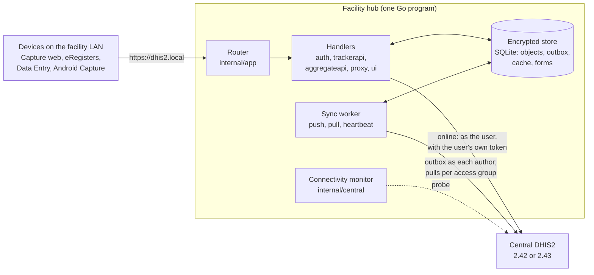

# Architecture

How the facility hub works inside: how it routes requests, who it acts as, what it stores, and how it syncs with central. Checked against the code on 27 November 2026 (v0.2.0).

The facility hub is one Go program on the facility's LAN that stands in for central DHIS2. While central is reachable, it passes each request through as the user who made it, and keeps what it sees. When the uplink drops, the hub answers from its own encrypted copy of the facility's data. It queues writes, then sends them to central as their authors once the line is back. Clients do not change: the Capture web app and eRegisters run in the browser at `https://dhis2.local`.

This document describes release v0.2.0, for DHIS2 2.42 and 2.43. The binary is pure Go: SQLite is included and compiled to Go, so there is no C toolchain. The source of truth for each claim is the repository: the other documents in `docs/`, and the package comments, which name their invariants and the tests that guard them. Numbers such as R-04 refer to the independent review of 10 November 2026, and letters with numbers such as D6 or F4 to the adversarial scenarios ([ADVERSARIAL-TESTING.md](ADVERSARIAL-TESTING.md)); the fixes are in [FINDINGS.md](FINDINGS.md).

Related documents: the code layout, configuration and releases are in [DEVELOPMENT.md](DEVELOPMENT.md); what works offline per app in [SUPPORTED.md](SUPPORTED.md); measurements in [PERFORMANCE.md](PERFORMANCE.md); keys, sealing and the threat model in [SECURITY-DESIGN.md](SECURITY-DESIGN.md).

## At a glance

Online, each handler passes the request to central with the user's own token and stores what comes back. Offline, the handlers answer from the store. Once central answers again, the sync worker pushes the outbox and pulls what changed. Where a country lists programmes for local reads, the hub also answers those programmes' reads, and its users' metadata, from the store while online; saves still go to central.

## Routing a request

The router (`internal/app`) looks only at the path. Whether the hub answers itself depends on the connectivity monitor (`internal/central`) and, while online, on the local-reads setting (below).

The monitor probes central every 15 seconds while offline and every 60 seconds while online, each time on a new connection (D6). It goes offline after 2 failed probes and back online after 1 success. A failed upstream request (a timeout or a lost connection) asks for a probe at once, and the probes decide by their usual rule, so one slow query does not take every user offline (R-21). A request the client cancelled, as a browser does at logout, asks for none (`central.Client.Failed`). An `/api/` answer that cannot be central's, such as an HTML page where JSON was asked for or a redirect to another host, counts as central unreachable: a captive portal takes the hub offline, and nothing of its answer is kept (D7).

Before routing, the router checks the request:

- The `Host` header must be one of the hub's own names, as a defence against DNS rebinding.
- Versioned paths such as `/api/42/tracker` are mapped to their plain form, since Capture calls the versioned ones.
- A request without a login may carry at most 64 KiB, enough for a login, so nobody on the facility network can run a 1 GB Pi out of memory.
- `/api/tracker` takes at most 16 MB, since an import costs 7 to 15 times its size in memory, and bodies over 4 MB are imported one at a time (I8c). The limit leaves room for Android, which posts all its unsynced data in one request.
- A path that is not clean (a double slash, a "..") gets 400, since the cache and the replay would read it differently. Request headers are capped at 64 KiB (R-16, R-06).
- Hub pages take a form post only from their own origin and scheme, and log out only by POST (R-35, R-36).

With `log_requests` on, `hub.log` gets each request's parameter names, as `requests.log` does, not their values, which can be a data value or a comment.

| Path | Handler | Online | Offline |
| --- | --- | --- | --- |
| `/hub/*` | `internal/ui` | Hub pages: start page, setup, status, admin | Same |
| `/api/auth/login`, `/dhis-web-commons-security/logout.action` | `internal/auth` | Forwarded to central; registers the user on the hub | Opens the user's key slot |
| `/api/tracker/*` | `internal/trackerapi` | Passed through as the user; the hub stores what it sees and what was written. Reads of programmes listed for local reads are answered from the store | Answered from the store; imports checked and queued; notes on existing events and enrollments taken and queued |
| `.../generate`, `generateAndReserve`, `requestValues` | `internal/trackerapi` | Passed through, never cached; from the pool when central fails mid-request | From a pool reserved on central (500 per attribute by default) |
| Aggregate forms and data values | `internal/aggregateapi` | Passed through and stored per form | Answered from stored forms; edits queued |
| Everything else: metadata, app files, `/api/me` | `internal/proxy` | Passed through as the user; GET answers cached per user. With local reads, metadata from the user's copy. App files from the hub's copy when central answers 304 | Replayed from the cache; an app page never fetched gets another app's page (central serves the same shell page for every app) |

Offline, the hub fails closed. Whatever it cannot decide exactly as central would gets "needs connection". That covers:

- unknown query parameters (400), apart from one central ignores too: `pageNumber`, which Capture web's search by a unique ID sends as `pageNumber=1` (central answers page 1 on 2.42.8 and 2.43.2.1);
- unsupported `orgUnitMode` values (503);
- deletes, file values and min-max edits;
- writes that depend on attribute option combos only central can check.

A record the hub lacks and one the user may not see get the same answer, so a miss reveals nothing. [SUPPORTED.md](SUPPORTED.md) lists what works offline per app, and the endpoints and parameters the hub answers offline, generated from the hub's own tables (`TestSupportedDocUpToDate` fails when it drifts). Images and files always need a connection: the hub keeps none ([FINDINGS.md](FINDINGS.md), "Images and files").

When central comes back, the hub keeps answering tracker and aggregate requests itself until it has pushed every entry it can (`core.PassThrough`). New writes queue behind the offline ones. Otherwise a person registered offline an hour earlier would be missing on central while a client already wrote to them. The first push waits a random time of up to five minutes (`reconnect_delay`), so 500 hubs do not reach central in the same second after a national outage. While staff keep saving faster than the hub pushes, it keeps answering locally with the uplink up, until the saving slows down. Nothing is at risk, and this was accepted.

### Local reads

The hub can also answer staff while online ("local reads", off by default). A country lists programmes in `facility-hub-config/localReads` (Facility Hub app, Settings), and hubs read the list within an hour. For a listed programme, the hub answers tracker reads from its store once it has finished a full pull of that programme for the user (`internal/trackerapi/localfirst.go`). Searches over the user's whole scope stay with central unless that scope is the facility alone, and whatever the hub cannot answer goes on to central.

Saves, reserved IDs and validation always go to central while online. The hub learns from central's answer, so the next screen shows the save, and changes made elsewhere arrive with the next pull, 15 minutes by default. Metadata and settings come from the user's own copies under the cutoff rules in "Metadata and app files". Under the typical rural conditions of [CONNECTIVITY.md](CONNECTIVITY.md) (31 KB/s, 1 s per request, 3 % loss), Capture's dashboard went from 4.4 s to 0.12 s and its start from 19 s to 4.8 s.

## Users, logins and tokens

Every request reaches central as the user who made it, with that user's own personal access token (PAT). The hub never sends patient data under a shared account.

At an online login (`internal/auth`), the hub forwards the login to central. If central accepts it, and the user has the hub's facility in their capture scope, the hub registers them:

1. It creates or renews the user's PAT on central. The PAT lasts as long as the country's setting (7 to 365 days, default 90) and is renewed while online.
2. It adds or refreshes the user's key slot: the data key, wrapped under a key derived from their password (see "The store", and [SECURITY-DESIGN.md](SECURITY-DESIGN.md)).
3. It reads and stores the user's access list: programs, stages, tracked entity types and org unit scopes.

A user without the facility in their scope passes through without a key slot or PAT. They can use the hub online, but not offline, and they cannot write locally (403). The same holds for accounts that can manage users or roles (`ALL`, `F_USER_ADD`, `F_USER_DELETE`, the role-adding authorities, `F_REPLICATE_USER`, `F_IMPERSONATE_USER`): one staff password and the hub's disk would otherwise open a token that gives any account on central (R-25). A registered user who gains such an authority loses their token, on central too, and their offline login at their next online login.

At an offline login, the hub opens the user's key slot with the password. That one step checks the password; after a restart, it also unlocks the store. Unlocks run one at a time, and a login that comes during one waits for it (`Hub.Unlocked`), so no save reaches an index that is not loaded yet. An unknown name and a wrong password get the same answer. The login page itself comes from the public file, which the hub reads while the store is locked ("Metadata and app files").

Sessions (`internal/core/sessions.go`) use an HttpOnly, SameSite=Lax cookie for web clients. A session ends after 1 hour idle, or 12 hours after login. Sessions are kept in memory only, so staff using a browser log in again after a restart or an upgrade. Android sends Basic auth with every request instead. When central refuses a Basic password, the hub ends the user's sessions only if that password worked before; any other gets central's 401 and counts as a failed login, so one request per username does not lock staff out of offline work (R-05). The hub caches that check and, while online, repeats it with central every 5 minutes, so a user disabled on central is refused within minutes.

Through a token it is slower. Central caches a token's login, with the user's access as it was, for an hour (measured on 2.42.7), and the hub refreshes access hourly. An access change on central therefore reaches the hub within about two hours. This was accepted ([FINDINGS.md](FINDINGS.md), "Tokens outlive their user"); deleting the user's tokens on central ends it at once.

Failed logins are throttled (`internal/auth/throttle.go`):

- They count per user and device (5), per device (20) and per user (50) within 15 minutes. Past those limits, the wait starts at 30 seconds and doubles up to 15 minutes.
- Argon2id derivations run two at a time, so a burst of guesses cannot exhaust memory.
- During a lockout, a cached Basic credential passes only from the address it was verified from (L2).
- An attempt counts before the password is checked, so parallel guesses are counted too, and a counter is forgotten 15 minutes after the last failure, not the first (R-04).
- The setup, take-over and move codes go through the same throttle.

Without a PAT, offline changes are refused, not queued. An older fallback that kept the password for pushing is off by default (`password_fallback`).

Users central refuses, after a changed password or a disabled account, are marked "needs online login". Their queued writes wait while the rest of the outbox is pushed. A disabled or deleted user never logs in again, so after 7 days without an online login the hub refuses those writes itself, with the code `NO_LOGIN`. A hub manager can resend them as another hub user, whom central then records as their creator. Key slots of users who have not logged in for `key_slot_max_age` (90 days) are removed; the three most recently used slots are always kept.

## Metadata and app files

The hub never owns or configures metadata. It caches central's answers per user, as each user fetched them, and replays them offline (`internal/proxy`).

Online, a request the hub does not handle itself goes to central with the user's PAT. Headers that would confuse central, such as the browser's `Origin`, are dropped. GET answers with status 200 or 404 are stored in `http_cache`, keyed by user, method and URL, and sealed per row. The 404s matter: apps probe optional dataStore keys and icons, and treat "not found" as an answer.

The cache holds central's answers in central's own form. On the way out, absolute central URLs (the pager's `nextPage`, job locations, the app shell's base URL) are rewritten to the host the client used. A copy cached for one host is therefore never replayed to another client with that host in it (`TestHostHeader`).

Offline, the hub serves the user's own cached copy. It answers three requests itself:

- `/api/me`, from the user's stored profile with DHIS2's `fields` selection applied;
- `/api/ping`;
- `/api/system/info`, for a logged-in user with no copy of their own, from the hub's own copy. The hub reads it each cycle with its own token and cuts it to the fields any staff member gets (`core.PrivateSystemInfo`, `TestSystemInfoOfflineForAnyStaff`). Android's first request after a login is this one, so a first Android login offline no longer fails on it. It is never served before a login.

Anything never fetched online gets "needs connection". Two kinds of answer are never cached or replayed: validation, which offline always gets "needs connection", and generated attribute values (`generate`, `generateAndReserve`, `requestValues`), which come from central or the hub's pool. A cached generated value replayed after a failed request was a value already used (`TestGeneratedFromPoolWhenCentralJustWentAway`).

### What is shared between users

Only what holds no user data, and is the same for everyone, may come from another user's copy: app static files, the login page configuration (`loginConfig`), `staticContent` and `locales` (`sharedPrefixes` in `internal/proxy/proxy.go`). Metadata never does, because DHIS2 sharing can differ per user for any metadata object. A user who never loaded a program, an option set or the org unit list online gets "needs connection" for it offline. The same holds for `/api/me`, user settings, the user dataStore, tracker data, working lists and tracked entity filters. `TestPerUserMetadataNotShared` and `TestOfflineStaticCache` guard this. A request without a session is cached only for the login page's files and settings, without a query string, so one device cannot fill the disk with copies; the apps menu, which central answers per user, is not shared (R-16, R-18).

### The login page

The login page and what it loads are kept apart, in a plain-text public file next to the key file (`hub.db.public`, `internal/store/public.go`). That is the login app (`/dhis-web-login/` on 2.42; on 2.43 that path is a 301 to `/login/`), `loginConfig`, `locales/ui`, the `staticContent` logo and the images under `/dhis-web-commons/flags/` and `/dhis-web-commons/security/`. Central gives them to anyone without a login.

The hub keeps them whenever a device loads them online, locked or not, and serves them offline from that file, locked or not (`publicAnswer` in `internal/proxy/proxy.go`, `TestLoginPageOfflineWhileLocked`). Without this, nobody could log in from a browser after a restart without internet, and so nobody could unlock the store ([FINDINGS.md](FINDINGS.md), "The demo of 13 November 2026"). The file is capped at 16 MB, oldest copies first (`TestPublicCopiesLockedAndCapped`); a reset empties it, and it is not on the USB stick.

The hub also loads the page itself as soon as it reaches central, and again each day, so it does not wait for a device. It follows the page's relative references as a browser does, under the login app's path, then the settings, logo and flag the page asks the API for: 32 answers, 1.3 MB on 2.43.2.1 (`internal/proxy/loginwarm.go`, `TestLoginPageKeptWithoutADevice`).

### Misses and the replay

Every GET the hub answers with "needs connection" is marked `X-Hub-Needs-Connection` and counted per path template (`app.countMisses`). The heartbeat carries the 10 most frequent (`offlineMisses`) and the total (`offlineMissesTotal`). The Facility Hub app lists them as "Not available offline" on the hub's page (`TestOfflineMissesInHeartbeat`).

These counts led to the replay (`internal/proxy/replay.go`). At a staff member's online login in a browser, the hub loads in the background, with their own token, the requests clients made through it in the last 14 days that this user has no copy of from the last day: one at a time, 200 ms apart, at most 300, once a day per user. Central answers as that user, so nothing is shared between users. Data, generated values, validation, `/api/me` and requests naming another hub user are never replayed. The replay also loads, for every user, Capture's page layout entry (`dataStore/capture`), which nothing else asks for and without which Capture's enrollment dashboard crashed offline (`loadedAtLogin`, `TestReplayLoadsCaptureLayout`).

Each online request refreshes its cache row; rows not fetched for 30 days are pruned. When a browser asks conditionally (`If-None-Match`) and the hub holds no copy of its own, the hub asks central for the full answer, since a 304 cannot be replayed offline.

### App files

App files are checked, not downloaded again. When a browser asks for an app file without a copy of its own (a new tablet, a cleared cache, after a Capture update), and the hub holds one, the hub asks central as the user whether its copy is current. On a 304 it serves the copy over the facility network. Capture's start with an empty browser cache went from 77 s to 6.4 s at 31 KB/s (`proxy.revalidate`, `TestAppFileFromHubCopyWhenCurrent`). This does not depend on local reads.

Offline, an app page `/apps/<app>` that the hub never fetched is answered with the latest cached app page. Staff who switch apps inside the 2.42+ global shell never load that page, and central serves the same page for every app (checked on 2.42.7.1 and 2.43.2; `TestOfflineAppShellAndConditionalGets`).

### Metadata while online, with local reads

With local reads on, the hub answers a user's metadata and settings requests from that user's own copy while online too. It does so only for a copy fetched after a cutoff (`internal/core/metadata.go`). The cutoff moves to now for everyone when the hub learns that something changed:

- the hourly check finds metadata changed on central;
- a hub manager presses "Refresh metadata on all hubs" in the Facility Hub app (`facility-hub-config/metadataReload`, read at every sync);
- someone presses "Refresh metadata now" on the hub page;
- a setting or data store entry is written through the hub.

For one user, the cutoff also moves when their access changes, since their copies were fetched with the old access. Offline nothing changes: the hub serves the copies it has.

The hourly check asks central which objects of 20 metadata types changed since the last check, as one member of each access group, starting ten minutes back in case the hub's clock is ahead. Org units and category option combos are left out, since central reads each type's whole table for it. The check does not see deletions, which central lists only to superusers, or assignments of programmes and data sets to org units, which change no `lastUpdated` (checked on 2.42 and 2.43); the national refresh covers both. Settings and app configuration refresh at each user's online login when older than a day. On the eRegisters configuration the check cost central 2 requests and 6 ms of database time.

`/api/me` is answered from the copy kept at login only when that copy holds every field asked for. eRegisters 1.1.9 asks for its org units' programmes (`organisationUnits[id,name,path,programs[id,name],…]`), which the login copy lacks; such a request goes to central while online, and offline the hub serves the best it has (`TestMeNestedFieldsWhileOnline`).

## Tracker data

The hub holds the facility's tracked entities, enrollments, events and relationships. For each user, it also records which of them central showed that user. It never evaluates DHIS2 sharing itself; central decides, and the hub remembers the answer.

### How data arrives

Pulls (`internal/sync/pull.go`) run each sync cycle, once per access group. A pull first lists identifiers and update times only. It then fetches in full, 50 per request, the people the hub lacks, holds with another update time, or has not fetched for that program.

- Each incremental pull starts 5 minutes before the newest update time of the last one (`pullOverlap`). A record stamped before that time and committed after the listing read it, as in a long import on central, therefore does not wait for the weekly full pull. A record listed again with the time the hub holds is not fetched again (R-34).
- A held record is fetched when central's update time differs from the copy's, not only when it is newer, and a pull leaves alone a local save made since it read (R-02, R-33).
- A pull that replaces an object written on the hub shares it by the hub's rules, as an online save is (`core.ShareByRules`), so an author keeps seeing her own registrations between the push and her own group's pull (`TestM2AuthorKeepsOwnRecordsAfterPush`).

Users whose access lists are the same apart from who they are share one listing per cycle (`access.List.GroupKey`); programs with an attribute category combination stay per user. Shared listings cut the load on central from about 53,000 to about 9,400 requests per hub per day ([PERFORMANCE.md](PERFORMANCE.md), "Load on central").

What a user reads or writes through the hub while online is stored too (`UpsertCentral`, `ShareByRules`). A colleague therefore sees a new person even if the line drops a minute later.

The first pull starts at set-up, and again at each user's first online login. At the HC IV size (300,000 people) it takes 15 minutes on a Pi 5 for 60 users. Only objects the facility owns are stored. An enrollment read online through temporary ownership ("break the glass") is not kept once the connection ends. An event of a tracker program is the facility's only when the hub holds its enrollment as the facility's (`core.UpsertCentral`), so a referred-in event read online is not kept either (C10).

### Who sees what

Each stored object has a stable slot number, and each user a bitmap over the slots. A bit is set when central listed that object to that user. Bitmaps live in memory, and on disk in 512-byte chunks (`visibility_bits`): under 5 MB for 60 users and 750,000 objects.

Records written at the hub, and not yet on central, follow a local rule (spec 8.2). The user needs read access to the program, stage and tracked entity type, the facility in their search scope, and read access to the record's option combinations.

Removing visibility needs a full pull. One runs weekly, or at the next cycle after a user's access list changes; objects it did not list to a user lose that user's bit. Tracked entities belong to no program, so they lose a bit only when every program's pull for that user succeeded: a program whose pull failed hides nobody.

Ownership is checked hourly, and a person transferred out is hidden from everyone offline (`ApplyTransfer`). The same check fetches again the people central lists as the facility's that the hub held as owned elsewhere, so a person transferred back on central shows again within an hour. The catalog refresh also reads the facility's org unit path again, so a facility moved to another district is no longer served offline to the old district (A12).

### Retention

Each program can have a window, set in `facility-hub-config/retention` on central. Active enrollments stay in full. A completed or cancelled enrollment whose last change is older than the window becomes a stub: no data, no events, never read. It is kept only for the "enrol once" check (E1016). People are kept, so offline search and duplicate checks still work, unless a window is set for their tracked entity type: then a person goes when they are old and have nothing left in full. At the HC IV size kept for five years, a 12-month window shrinks the data file from 16.2 GB to 6.5 GB ([PERFORMANCE.md](PERFORMANCE.md), "Retention for tracker programs").

### Searches and paging

Searches read the encrypted data file directly; there is no copy in memory (`internal/tracker/search.go`). Each search is a plan in two halves, and both must mean exactly what central means:

| SQL, in the data file | Go, per row |
| --- | --- |
| Facility, program, type, kind, status, creation date, update time | The visibility bitmap or the local rule |
| Attribute values (`te_attrs`), exact or contains | Program, stage and attribute read access |
| Creation order, read in growing chunks until the page is full | Exact date filters, other sort orders, `updatedAfter`, field selection |

A page that follows the one just served reads on from that page's last row (`pagePositions`: one row ID per user and query, kept ten minutes). A device downloading a whole facility therefore pays the same for page 1,000 as for page 1: 17 to 36 ms per page at 300,000 people. How the store, the bitmaps, the pulls and paging scale, with their numbers, is in [PERFORMANCE.md](PERFORMANCE.md), "How the hub scales".

Orders follow central's. Central orders by the column asked for, then by creation time, newest first, then by UID, and the hub's SQL and Go sorts do the same (`TestEventListTieOrderMatchesCentral`). Events ordered by `scheduledAt` or `completedAt` come in that order, and events without the date sort as central's database sorts NULL: last ascending, first descending (`TestEventsOrderedByScheduledAt`).

Offline answers carry `X-Hub-Scope: facility`, since patients registered elsewhere cannot appear. The live oracles in `internal/live` run the same queries against real DHIS2 and compare the answers; they find no LEAK or DIFFERS. Each profile (synthetic, Sierra Leone, Laos) and DHIS2 version (2.42, 2.43) has a checked-in baseline in `internal/live/testdata/oracle`. One case counts as accepted: a person owned elsewhere, opened offline with a protected program, gets only what central shows the same user without the program. `TestQueryPlansUseIndexes` fails if a query scans a table, and `TestFirstPageReadsOnWithoutGaps` checks paging.

Both halves use only attributes the user can read. An event filter on an attribute of a program the user cannot read matches nothing, and a sort on one sorts as if empty (R-03). An order central refuses gets central's 400 instead of being ignored (R-51). Fuzz tests hold SQL and Go to the same answer for the filter and order parameters.

## Writes: the outbox

Online, a tracker write passes through to central as the user; the hub then stores the objects central accepted. Offline, the hub accepts the write itself. It queues the write and sends it later, as its author.

Capture web registers a person with an enrollment that has no UID. Central assigns one and names it in its import report, and the hub gives that UID to the single object sent without one, so its copy holds the enrollment (`TestLocalReadsRegistrationWithoutEnrollmentUID`). The report does not say which UID belongs to which object, so with more than one object sent without a UID the person shows without them until the next pull. Capture has not been seen to send that.

### Accepting writes offline

Before saying yes, the offline importer (`internal/tracker`) checks what it can decide exactly as central would:

- structure and references;
- the user's access, under the local rule;
- unique attribute values among the records it holds;
- number values, by central's rule: plain decimal notation, and the integer types within 32 bits (E1007 for an attribute, E1302 for a data value; `internal/valuetype`, `TestValidAsCentral`);
- non-repeatable stages and "enrol once";
- dates: an event in an expired period (E1047, unless the user has `F_EDIT_EXPIRED`), reopening a completed event without `F_UNCOMPLETE_EVENT` (E1083), and, where the program allows no future dates, an enrollment or incident date after central's today (E1020, E1021);
- ownership.

Where central would have to decide, it refuses with "needs connection". Accepted objects are stored with `origin=local` and `sync_state=pending`. Their `createdAt` and `createdBy` are kept, and their times are stamped in central's time zone. Async import jobs are emulated. The client's import flags, such as `skipSideEffects`, are kept and sent along. The hub passes clients' writes to central unchanged; the outbox keeps the payload as the client sent it. One exception is in the hub's offline copy only: it names the author with first name and surname, as central does, because eRegisters drops records without them (spec 10.2).

Client input is checked at the boundary (R-01, R-02, R-10, R-11):

- A relationship end must be of the kind its reference names, and of a type central has and the user may write (E4012, E4006, E4020).
- An update cannot move an enrollment to another program or person (E1127), or an event to another stage or enrollment (E1128).
- The fields that are the hub's (`deleted`, `createdAt`/`By`, `updatedAt`/`By`) are not taken from the client, and an `importMode` other than COMMIT needs a connection.
- A user without read access to a program's tracked entity type sees none of its enrollments and events offline, and their writes to it get E1104, as on central (checked on 2.42.7.1 and 2.43.2.1).

Offline imports run one at a time from validation to storage (R-33). Otherwise two imports of one new UID could both validate as creates, and both pass the unique-value and enrol-once checks.

The future-date check (F4) uses the hub's clock in central's time zone and answers with central's 409, codes and text, so staff see the refusal at the save, as they do online. Without it, the hub confirmed such saves and central refused the enrollment at push: Android marked the record synced while central held the person without the enrollment. The program settings come from the hub's catalog, which is read again with the hourly access refresh, so a setting changed on central is followed within the hour (A21; the wait was accepted).

Android Capture sends its device time with each record (`createdAtClient`, `updatedAtClient`). The hub's page lists users whose device ran more than half an hour ahead of central's clock at their latest upload, and the heartbeat counts them (`clientClocksAhead`). Capture web sends no device time, so the warning covers Android only.

Each import becomes one outbox entry (`PersistImport`). It holds the sealed payload, its author, and `depends_on_seq`: the latest pending entry with any object this one refers to or updates. Until it is pushed, a pending local version wins over central's.

### Notes

Capture web adds a note to an existing event or enrollment with `POST /api/tracker/{events|enrollments}/{uid}/note`. On central that request adds the note and changes nothing else on the record, not even `updatedAt` (checked on 2.42.7.1 and 2.43.2.1). Offline, the hub takes the request, adds the note to its copy at once, and queues an outbox entry of kind `note`, filed under its record so Resend and Discard reach it (`internal/trackerapi/notes.go`, `internal/sync/notes.go`). At the push it makes the same request as the author. Central's E1003 for a repeat counts as sent; a record deleted on central gives a refusal that is kept (`TestNotesOffline`).

### Pushing

The sync worker (`internal/sync/push.go`) pushes every cycle:

1. Entries go in sequence order. An entry whose parent entry is still pending waits.
2. Each is sent with its author's PAT: `POST /api/tracker?async=false&atomicMode=OBJECT&importStrategy=CREATE_AND_UPDATE`. Central records the author as creator, as if they had been online.
3. An object counts as accepted only if it appears without errors in central's `bundleReport`. With `atomicMode=OBJECT`, central answers 200 "OK" even when it refused objects, and it may ignore children of a refused parent without an error of their own.
4. Objects whose parent was refused are not sent. They are marked "blocked by" that parent.
5. A network error stops the push until the next cycle. So does an answer from the way to central and not from central itself: a redirect, 408, 429, 5xx, an answer cut off, or a body that is no import report. Such answers are not refusals.
6. A 401 marks that author "needs online login" and skips only their entries.

Two rules keep one bad entry from holding up every save behind it. An entry that keeps getting a page that is no import report (a proxy's 413, a firewall's 403) is refused with it after a day (`outbox.failing_since`). A plain 500 on one entry does not stop the push: the rest go on, entries that depend on it wait, and it is refused after a day of 500s (H8). An answer without `bundleReport` is an import report only when central refused (N14).

"Last push" moves only when central answered a push, not when the outbox was found empty (`TestLastPushOnlyWhenCentralAnswers`). The Facility Hub app's "pending" flag reads the heartbeat's `oldestPending`, the time of the oldest waiting save.

The push sends one save per request, one at a time, so the link's latency sets its speed, not bandwidth. Measured: about 7 saves a second over a 4G-like link (100 ms), 2.8 over a poor one (300 ms), 37 without limits. A busy HC IV's day offline, about 3,000 saves, then takes about 7 minutes over 4G, after up to 5 minutes of `reconnect_delay` ([PERFORMANCE.md](PERFORMANCE.md), "Push over a slow uplink").

### Offline edits and newer changes on central

An offline edit can replace a newer change made on central meanwhile, and nobody is told: central keeps the last save it receives and does not compare versions. Where the app sends every attribute or value of the record, not only the changed one, the stale copy also puts back fields the nurse never touched. Within the facility nothing new happens, since every device saves to the hub's one copy. The case needs one record edited both through the hub and on central while the hub is offline. Android Capture on its own does the same.

The hub counts these cases (`internal/sync/overwrites.go`, telemetry only; the push goes ahead whatever it finds). For each offline save that edits a record the hub held as central's, it keeps central's `updatedAt` of the copy edited (table `outbox_base`). Before pushing one such save in ten, it reads central's current `updatedAt` of those records with the author's token, and counts the save if central changed the record since. The heartbeat carries the count and the recent cases (`overwrites`, `overwritesSampled`), without values, and the Facility Hub app shows them on the hub's page. Registrations, new events and edits of records made on the hub cost nothing. A country turns the count off with `facility-hub-config/overwrites` = `{"off": true}`. What to tell staff, the measured cost and the options if the case proves common are in [DEPLOYMENT.md](DEPLOYMENT.md), "Offline edits and newer changes on central".

### Refused changes

A refused change stays on the hub with the hub's data. The client was told it was saved, so offline reads keep showing it. Central gets an issue in `facility-hub-issues` with its own error codes; every value the hub sent is replaced by `***`. The design is in [design/2026-11-04-refused-changes.md](design/2026-11-04-refused-changes.md).

A refusal that someone can fix closes when a fixed version is sent through the hub and central accepts it. When central's version changes after the refusal, because someone changed the record online, the hub's copy follows central's, so offline reads match it. The refusal itself stays open as superseded until a hub manager resends the change on top of central's version or discards it (R-22). The issue on central is reported again with `"superseded": true`, the heartbeat counts such refusals, and the Facility Hub app marks them. Whether central's version changed is judged by central's clock only: its answer's `Date` header, with one second of margin.

**Resend.** When a metadata change makes central refuse many saves, a hub manager fixes central and presses Resend on that group (kind, program, error code) in the Facility Hub app. Each hub then sends those saves again as their authors, with what they blocked (`facility-hub-admin/retries`). For saves refused with `NO_LOGIN`, Resend can name another hub user to send them as. When central is restored from a backup, what it accepted after the backup is central's to recover; the hub sends nothing again and answers only for what central has not seen.

**Discard.** When central was changed on purpose and the refused saves no longer fit (a new rule, a closed period, a duplicate), a hub manager presses Discard instead, on a group or on one change. Each hub then throws those saves away once, with what they blocked. For each record it keeps central's version, read as the author, or a tombstone where central has none, so Android's next download drops it. The tombstone is made only for a record created on the hub whose save central never accepted (R-47). Central answers 404 alike for a record it deleted and for one the author may not see (checked on 2.42.7.1 and 2.43.2.1), so any other record central does not show stays refused, with the reason in the heartbeat. The discarded outbox entry is kept 30 days.

Resend and Discard reach the hubs as signed instructions in `facility-hub-admin/retries` (see "Signed instructions"). A group Resend or Discard carries the org units of the manager who asked, and a hub applies it only if its facility is under one of them, and only to saves refused before the instruction. The app asks for confirmation and says how many saves on how many hubs each one reaches (R-30a).

**What staff and managers see.** The issue names the author by username as well as by user UID, and for an enrollment or an event it also carries the person's UID. On a hub's page the Facility Hub app shows the author, an "Open in Capture" link to the record on central, and who closes the refusal, by its error code: the author, central, or nobody. A change blocked by a refused parent closes with the parent.

Neither Capture app shows a refusal that comes at push. The hub's own page (`/hub/ui`) therefore shows signed-in staff their own open refusals under "Your sync errors", newest 100: one per record as "\<date> | \<org unit>", as Android words it, with central's message, the values they entered, and the same line on who closes it (`TestOwnRefusalsOnHubPage`). Other users' refusals stay in the issue table, masked, and a visitor who is not signed in sees neither. Each refusal the author fixes links to Capture at the hub's address.

For a record that holds an open refusal of the signed-in user, the hub answers that user's tracker reads from its copy, online too, so Capture shows what they entered. Android Capture sends only the fields changed since its last sync, so the hub fills such a save from its copy before it goes on. It sends it as `CREATE_AND_UPDATE` when every object in it is the user's own open refusal: Capture sends UPDATE, which central refuses for an event or enrollment it never had (E1032, E1081). Once central accepts the save, the refusal closes at once and the saves that waited for that record are sent again (checked live on 2.42.7.1).

**Records deleted on central.** A change to a record central has deleted (E1082, E1113, E1114, E4017) can never pass: DHIS2 has no undelete (checked on 2.42 and 2.43). After each push the hub turns its copy into a tombstone, with what the change blocked, marks the outbox entry discarded (kept 30 days) and closes the issue, on the hub and in `facility-hub-issues` (`TestMootRefusalClosesItself`). Offline the record leaves the lists, and Android's next download marks it deleted. The tombstone stays as the hub dated it when the next pull brings central's deleted copy (`core.UpsertCentral`). Central's deletion can be older than a tablet's last download from the hub, and a tombstone with that date would never reach the tablet. Reading the open issues at each push costs 3.4 ms with 2 of them and 0.8 s with 5,000.

### Generated values

Generated values (`generate`, `generateAndReserve`, `requestValues`) come offline from a pool reserved on central.

- The pool's size is set per attribute in the Facility Hub app (`facility-hub-config/reserved`, 500 by default, at most 5,000). A target of 0 turns an attribute's offline pool off.
- The hub refills a pool when it falls below a quarter of its target, in requests of at most central's 1,000 (`Worker.RefillPool`). The refill runs before the pull, since a user's first pull can take many minutes and their programmes' generated attributes would have no values if the link dropped during it (`TestPoolFilledBeforeFirstPull`).
- One request gets at most 100 values, Android's own request size, and at most half the pool's target, so one device cannot leave the others without values.
- When a generated-value request fails on the way to central, in the seconds before the probe notices central is gone, the hub answers it from the pool, as it does offline. Generated values are never cached, so a value is never handed out twice.
- When central cannot give as many values as asked for (a short pattern such as `ORG_UNIT_CODE + "/" + RANDOM(###)`, with 1,000 values per facility), the hub asks for half as many, down to one, and keeps what it gets. A pool still below its low watermark is a sync error, shown on the hub page (`TestPoolWhenPatternRunsShort`).
- When an attribute's pattern changes on central, the sync empties that pool and refills it under the new pattern (A22, `TestReservedPoolPatternChange`).

## Aggregate data and event programs

Aggregate forms (`internal/sync/aggregate.go`, `internal/aggregateapi`) let the Aggregate Data Entry app work offline. Without the hub, the app queues writes in the browser, not per user. On a shared computer, the next user to go online sends the previous user's values as their own.

The hub holds each data set's forms for a window: the current period, earlier ones up to the retention (default 12 periods, per data set in `facility-hub-config/aggregate`), and the open future periods. Periods that expiry days or input periods have closed are left out. Each form is central's answer, stored sealed in `agg_forms`.

Per access group and cycle, the hub pulls one `dataValueSets` request (by `lastUpdated`), one `completeDataSetRegistrations` request, and one request per form that changed. Once a day it fetches every held form.

Each user's form metadata (`dataEntry/metadata`) is fetched again with the hourly refresh and at login. The hub asks with the ETag of its copy, and central answers 304 with no body when nothing changed (checked on 2.43.2; `TestAggregateRefreshNotModified`). With eRegisters' ten HMIS data sets that is 3.5 MB less per user per hour; central still builds each answer to compare the ETag, so its 0.5 s per request stays. Central's ETag misses two kinds of change, and the hub asks without the ETag when either happened since its last full answer:

- The user's org units, groups or authorities changed (checked on 2.43.2.1): a user added to a group that a data set is shared with got 304 and kept the old forms (`TestAggregateRefreshAfterAccessChange`).
- A data set was assigned to the facility or taken off it. The hub reads the facility's data sets with each access refresh, as the user: `GET /api/dataSets?filter=organisationUnits.id:eq:<facility>&fields=id`, one small request per user per refresh (`TestAggregateRefreshAfterDataSetUnassigned`).

Offline, the hub answers forms with pending edits on top. It works out the lock from central's answer, then from expiry and input periods as of now. Central 2.42 opens and closes data input periods by the day; central 2.43 compares with the moment, and the hub follows the version it talks to (`aggregate.InputOpen`, `DataSet.InputByMoment`, `TestF5InputPeriodPassesWhileOffline`). Edits go into the outbox as their author (`kind=aggregate`). Where central would refuse, the hub refuses with central's code: E2017 (locked), E2030 (wrong type, with number values checked by central's rule), E2031 (option combo) or E1100 (data set or data element). Repeated edits of one cell fold into one entry.

Some things are refused offline: file values, min-max edits, completing a form where validation is mandatory, and forms outside the window or never pulled. Those forms are answered as locked, so they never open empty and editable. The guards are `TestAggregateOracle`, the `TestAggregate*` scenarios and `TestAggregateDataEntryApp`. Aggregate data is small next to tracker: 48,000 values make a 31 MB data file.

Event programs (without registration) work like tracker data. They are listed per access group, with events inside the program's retention (`occurredAfter`). Tombstones are kept for Android's download, and offline writes are queued as their author. Event programs have no owner, so the ownership check skips them.

## The store

The store is SQLite in pure Go (`ncruces/go-sqlite3`), in three files (`internal/store/store.go`):

- The key file `hub.db` is plaintext, because it is read while the store is locked. It holds `meta` (hub ID, mode, central URL, proxy) and `key_slots` (one per user: username, salt, the wrapped data key).
- The public file `hub.db.public` holds the login page's public answers in plain text, so the page works while the store is locked ("The login page").
- The data file `hub.db.data` holds everything else.

The data file is encrypted page by page with AES-256-XTS, under a key derived from the data key with HKDF, and it is open only while unlocked. The WAL, the journal and temporary files go through the same encrypting layer. On top of that, payloads, PATs, access lists, cached bodies and outbox entries are sealed per row with AES-256-GCM. Each row's associated data binds its ciphertext to that row, so rows cannot be swapped. Keys, key slots and the TPM-sealed device key are described in [SECURITY-DESIGN.md](SECURITY-DESIGN.md).

| Table | Holds |
| --- | --- |
| `objects` | One row per tracked entity, enrollment, event, relationship: query columns, slim JSON for Go's filters, the sealed payload, `origin`, `sync_state`, `slot`, `stub`, `deleted` |
| `te_attrs` | Attribute values per person, exact and lower-case, indexed by (attribute, value) |
| `visibility_bits` | Each user's bitmap over object slots, in 512-byte chunks |
| `users` | Username, sealed PAT and access list, last login, the stick's key slot |
| `outbox`, `outbox_objects` | Queued writes in order (tracker imports, notes, aggregate edits), their author, `depends_on_seq`, state, attempts, `sent_at`; which objects each holds. Sent entries are deleted 30 days after central accepted them (`store.SentOutboxKept`), in batches; refused and waiting ones stay |
| `outbox_base` | Central's `updatedAt` of each object an offline save edits, for the overwrite count |
| `issues` | Refused objects and central's sealed error |
| `http_cache` | Cached GET answers per (user, method, URL), sealed, and whether replay loaded them |
| `agg_forms` | Aggregate forms, sealed |
| `pull_state`, `reserved_values`, `state`, `kv` | Pull bookkeeping, the generated-value pool, the hub's sealed runtime state |

Indexes follow the orders the apps ask for: Android's download by creation, working lists by event date (newest first), program lists by person creation. `objects_unsynced` is a partial index of the unsynced rows only; on a full Windows hub it took the status count from 9 to 15 s down to 1 to 8 ms. All writes go through one write lock. Statements are prepared once, and every commit is synced to disk.

The hub has four caches: decoded payloads, per-request lookups (`Viewer.memo`), prepared statements, and `pagePositions`. Each has one invalidation rule, written next to it in the code; AGENTS.md and [PERFORMANCE.md](PERFORMANCE.md), "How the hub scales", list them. A cache of paged results was tried and removed, because it hid a full read per page.

Migrations run when the store unlocks. They are numbered in `keyMigrations` and `dataMigrations`, and a released one is never edited. One that touches existing rows is timed at the `hc4-5y` size (4.6 million objects) before it is committed. Migrations sort through temporary files on the hub's disk, each encrypted with a random key, instead of in SQLite's 4 GB of memory. A full index rebuild over 4.6 million objects takes 26 s. Normal queries sort in memory (`temp_store=memory`), so no plaintext reaches the disk. The upgrade from v0.1.5 to v0.2.0 adds one table (`outbox_base`) and changes no existing row.

The data file takes about 3.3 KB per object: 2.5 GB at 100,000 people, 6 to 7 GB at the HC IV size. The hub's own heap stays near 20 MB at any size. The rest of the RAM is file cache, and that decides the speed.

A damaged store says so. On the Windows VM, after its disk was unplugged, every unlock failed with "database disk image is malformed", and staff saw "Only staff assigned to this facility can open this page". The hub now keeps the first such error, and its login page, status and hub page say the store is damaged and what to do: restore from the USB stick, or delete the store and set the hub up again (`TestDamagedStoreSaysSo`). Without a stick, changes not yet on central are lost ([RECOVERY.md](RECOVERY.md)).

The hub's page shows a red line when less than 2 GB is free, offline too, with the space left (`TestDiskWarning`). A save that fails with under 50 MB free gets 503 "the hub's disk is full: the save was not kept", which clients retry, instead of a 500 "disk I/O error" (`TestSaveFailedOnFullDisk`). In the full-disk test on Windows (E7), saves were refused while the disk was full and confirmed again within a minute of freeing space, with no restart.

## The hub and central

A hub needs no configuration file per facility. It learns its facility at set-up, and everything else from central's dataStore and the Facility Hub app (`apps/facility-hub`, [FACILITY-HUB-APP.md](FACILITY-HUB-APP.md)).

### Set-up

At set-up, a staff member opens the hub's page and types central's address from the installation card (https with a publicly trusted certificate only). They enter the 8-digit setup code from the box's USB stick and log in. The hub finds its facility among their org units, registers in `facility-hub-registry`, and starts its first pull. On a Windows PC or a Mac, set-up is done on the machine itself and needs no setup code.

A hub serves that one org unit. Records owned by a unit below it, such as a community unit or a ward, pass through to central online and are not held offline, and users assigned only to such a unit keep using central directly. Set-up and take-over are refused until a superuser has named the hub owners group in the app's Settings, where the hub accounts and hub managers groups are named too. A restore from the USB stick asks for the setup code as well, and refuses a copy whose central is not an allowed https address (R-15).

### The sync cycle

The sync cycle (`internal/sync/sync.go`) runs every 15 minutes with ±10 % jitter. It also runs as soon as the uplink returns, after a random wait of up to five minutes. The steps run in this order, each at its own pace:

| Step | How often |
| --- | --- |
| Server version and time zone; the hub's own copy of `system/info` | Every cycle |
| Registry: is this hub still the facility's? | Every cycle |
| Resend and discard instructions, then push the outbox, in order, as each author | Every cycle |
| Renew the hub's token | Every cycle |
| Program list, users' access lists, the facility's data sets, a planned move of central | Hourly, and at login |
| Metadata changed on central (with local reads on) | Hourly; the national refresh every cycle |
| Remove unused key slots | Every cycle |
| Report refused writes | Every cycle |
| Refill reserved values | Every cycle; one request per attribute below its watermark |
| Pull ID lists per access group; fetch what changed | Every cycle |
| Full pull: settle what users may no longer see | Weekly, or after an access change |
| Ownership: who still belongs to the facility | Hourly |
| Aggregate pull | Every cycle; every held form daily |
| Retention, and pruning of the cache and of sent outbox entries | Every cycle |
| Heartbeat | Hourly |
| Check for an upgrade | After every cycle |

The push comes right after the registry check, before the hub's own housekeeping, which on a link that keeps dropping may never finish (D11). When writes arrived while the push ran and the push made progress, the next cycle starts at once. A cycle that cannot run logs why.

Load on central is about 9,400 requests a day per hub, or 54 a second for 500 hubs (`TestCentralLoad` in `internal/perf`). Requests do not measure central's work: a ping and a form's metadata are one request each. Central's database time per facility-day, with and without a hub and with local reads, and the hub's own traffic (about 50 MB a day), are in [PERFORMANCE.md](PERFORMANCE.md), "Central's load from one facility, three ways". In short: with Capture web, a hub passing everything through lowered central's database time from 82.5 s to 51.5 s a day, and local reads to 28.4 s. With eRegisters, which works from its own copy in the browser, a hub passing everything through added a little: 24.5 s against 21.9 s.

### Namespaces on central

| Namespace | Written by | Holds |
| --- | --- | --- |
| `facility-hub-registry` | Hubs | One entry per hub: facility, account request, the hub's public key |
| `facility-hub-status` | Hubs | The heartbeat: version, uptime, pending and refused counts by group, the oldest pending save, free disk, addresses, CA fingerprint, whether the keys are sealed by a TPM (`deviceKey`), the overwrite count, offline misses, the USB stick, 90 days of daily history with saves online and offline |
| `facility-hub-issues` | Hubs | One key per refused change: codes, UIDs and the author's username, no values; removed once resolved |
| `facility-hub-config` | National team | Retention for tracker, event and aggregate data; reserved-value pool sizes; programmes for local reads; the national metadata refresh; the overwrite count's switch; signed per hub |
| `facility-hub-admin` | Administrators only | Release choice and stage, resend and discard instructions, a planned move of central; signed per hub |
| `facility-hub-keys` | Hub managers | Each hub's move key |

`pending`, in the heartbeat and in `/hub/status`, is what still waits to reach central: tracker objects with unsent changes, plus aggregate values and notes (`Hub.Pending`).

Hubs write the record IDs and DHIS2 usernames of refused and overwritten saves to central, for the Facility Hub app. A country's data protection lead signs off on this before a national rollout ([DEPLOYMENT.md](DEPLOYMENT.md), "On central, before the first hub").

On 2.42 a new dataStore entry is writable by any user. Each hub therefore shares its own registry entry as readable by all and writable by the hub owners, hub accounts and hub managers groups, once a hub owners group is named in the Facility Hub app. The app creates the `facility-hub-admin` entries itself, protected, before anyone else can, and says when it cannot. Each heartbeat lists the entries the hub acts on that any user may write (`unprotected`), and the app flags them. Checked on DHIS2 2.42.7.

### Signed instructions

Sharing cannot tell the Facility Hub app's writes from those of a user who created a missing entry first and shared it read-only with everyone else (R-07, R-23, R-30a). The app therefore adds to each instruction it writes an `issued` time and one code per approved hub: the first 16 bytes of HMAC-SHA256 under that hub's move key, over the entry's name and content. An approved hub acts on `central-move`, `retries`, `release`, `accounts`, the `facility-hub-config` settings and the revoked status in its registry entry only with a valid code for itself, issued no earlier than the last one of that kind it took. It ignores the rest and names them in its heartbeat (`unsigned`), on its admin page and as a flag in the app (`TestSignedInstructions`).

A hub not yet approved has no move key. It ignores moves, retries and the settings, and uses the built-in defaults, so a first pull before approval keeps everything. Every hub manager can read every move key (accepted), so the codes keep out other DHIS2 users, not managers. Details are in [DEPLOYMENT.md](DEPLOYMENT.md), "Security operations", and [design/2026-11-11-signed-instructions.md](design/2026-11-11-signed-instructions.md).

### The hub's own account

The hub's own account (`internal/hubaccount`) does the housekeeping: heartbeat, issues, registry, reserved values and upgrade checks. It never carries patient data, which always goes with each user's own PAT.

A hub manager approves the account in the Facility Hub app with a 16-character code read off the hub's page. The app then creates user `<hub ID>`, assigned to the facility only and with no authorities, and hands the credentials over encrypted to the hub's key. Until then, the hub uses the PAT of whoever set it up. A request that will never be approved can be dismissed in the app; a hub that is still running asks again at its next refresh.

A 401 to the hub's token makes a new one at once with the account's password; if that fails, the hub's admin page says housekeeping fails (G9). A "revoked" mark in the registry counts only once central refuses the hub's token (L3). Revoke in the app writes a signed revoked status, deletes the hub's tokens, and disables the hub's user on central, or gives it a new random password where disabling is refused (checked on 2.42.7.1 and 2.43.2.1). A take-over of a hub with its own account is refused while central still accepts that account. A retired hub refuses aggregate values offline as well as tracker requests (G7).

### A move of central

The hub follows central to a new address (`internal/core/move.go`) only when the current central vouches for it. That means an announced move in `facility-hub-admin/central-move`, used only when no ordinary user may write that entry; a permanent https redirect seen three times; or a move code typed on the hub's page, which the hub checks itself. It never moves to a server that is not the same DHIS2.

### DHIS2 versions

What differs between DHIS2 2.42 and 2.43 lives in `internal/compat`, one file per version: pull and list paths, import reports, error shapes, PAT requests, transfer parameters and program fields. A difference that is simpler to read in both shapes stays in place, such as the two shapes of `dataValueSets` and the moment-based input periods of 2.43.

On a version a hub release does not support, the hub only passes requests through, and reports "hub needs upgrade". Online that holds even with saves queued; offline it answers nothing new. The queue stays in the store, and the upgrade to a release that supports central carries it over unpushed for that release to push.

### Central's time zone

Central's server time zone should be the facilities' own, or the easternmost of a country's zones. Central judges future enrollment and incident dates by its own date, while staff date records by their devices. With central in a zone to the west, every registration dated today is refused between local midnight and central's: 398 saves an hour each night in the Pi 5 soak, with central on UTC and the clients on UTC+1 ([DEPLOYMENT.md](DEPLOYMENT.md), "Central's time zone").

## Platforms and upgrades

The same code builds one binary per platform. The version is in the `VERSION` file (0.2.0); CI builds are `<VERSION>-ci.<run>`. Releases v0.1.5 and v0.2.0 are published on GitHub, signed with the release key.

| Platform | How it runs | Notes |
| --- | --- | --- |
| Raspberry Pi 4 or 5 (`image/`) | systemd service under its own `hub` user, `Restart=always`, hardware watchdog. Sandboxed, with a read-only system except its own folders, the USB stick and `/run/hub`. Polkit allows the hub only its own NetworkManager actions, and root, not the hub, writes the setup Wi-Fi's one captive DNS line when the hub sets a flag (R-26). The Pi takes central's time zone, so the 03:00 update reboot falls in the facility's night (R-31) | Raspberry Pi OS Lite 64-bit with NetworkManager, avahi (`dhis2.local`), chrony, nftables; no SSH, no console user, no secrets. Built in CI without mounts, checked by `image/check.sh` without booting. `image/test-build.sh` also builds a test image and a release to upgrade to, signed with a throwaway key, on a Mac with Docker. The first start grows the disk itself (`hub-growdisk`) and writes `hub-diag.txt` to the boot partition, with the previous start. The system journal stays on the disk, so an unexplained restart can be read afterwards. Set-up, offline login after a power cut and a push were run on a Pi 4 on 16 November 2026; the checks on a Pi after an image change (`image/README.md`) are open ([PENDING.md](PENDING.md), items 6 and 26) |
| Windows PC (`windows/`) | NSIS installer, for the whole PC only, by an administrator: a service under a virtual account (`NT SERVICE\DHIS2FacilityHub`), started at boot. An install for one user was dropped on 22 November 2026 | `hub init` picks ports and makes the authority; the installer trusts it, maps `dhis2.local`, opens the firewall. Set-up only on the PC itself. Windows 11 is supported; Windows 10 is untested. Run on VMs only: Windows 11 on ARM under x64 emulation (10 power cuts, no confirmed save lost) and a Windows 11 x64 VM with a virtual TPM (19 to 22 November 2026). No installer is attached to v0.2.0, since there is no code-signing certificate yet ([PENDING.md](PENDING.md), items 15 and 37; [WINDOWS-INSTALL.md](WINDOWS-INSTALL.md)) |
| Mac (`macos/install.sh`) | launchd agent | For the DHIS2 team to try the hub. Not for facilities |

### Network set-up on a Pi

On a Pi, network set-up goes through NetworkManager (`internal/netsetup`). With no cable network, the hub starts a setup Wi-Fi `Hub-<ID>` and serves a captive page. Its 8-digit password is in `facility-hub/hub.txt` on the USB stick, the one file on the stick meant for people, which also holds the setup code until set-up. Setting up a Pi therefore needs a device that reads the stick. From the page, staff join the clinic's Wi-Fi or MiFi, or make the hub the clinic's Wi-Fi with its own DHCP and DNS (case C). If the network is gone for 15 minutes, the setup Wi-Fi comes back.

The facility Wi-Fi of case C keeps the name `Hub-<ID>`, with a password the hub makes: 4 groups of 4 characters, about 80 bits, sealed as `facility-wifi`. It is shown on the admin page and in `hub.txt`. "New password" makes a new one, and every device joins again. A hub that joined another network and goes back to its own Wi-Fi reuses the stored password. The network cases are in [DEPLOYMENT.md](DEPLOYMENT.md), section 4.

### Clocks

A hub needs the right time: the deployment requires the Pi 5's RTC with its battery, or an add-on RTC on a Pi 4. Without one, a Pi on the hub's image that restarts with no network starts at the image's base date, not at its last saved time, until chrony reaches NTP (confirmed on a Pi 4, F1). The image's `hub-clock` saves the time every 15 minutes and at shutdown, and the next start begins there; its check on a Pi is open ([PENDING.md](PENDING.md), item 6). [DEPLOYMENT.md](DEPLOYMENT.md), appendix A, covers the hub with its clock wrong.

The hub notices when its clock is behind. It keeps the newest `Date` header central has sent it, stored so that it survives a restart without network. When its own clock is more than 10 minutes behind that, the future-date check leaves the dates to central at push, the device-clock warning is off, and the hub's page says "The hub's clock is behind" (`TestHubClockBehindLeavesDatesToCentral`). Some effects remain: the offline aggregate window follows the hub's clock and can offer an earlier month than the current one, and a hub behind the start of central's certificate cannot reach central until NTP sets its clock. A clock ahead lets future dates through, to be refused at push. On the Windows VM, a clock three hours ahead and one a month ahead lost no saves (F2).

### Upgrades

The hub upgrades itself (`internal/upgrade`). Each country chooses the version in the Facility Hub app (`facility-hub-admin/release`) and stages it: 5 pilot hubs, then 10 %, 50 % and 100 %. After a cycle, the hub downloads that release from GitHub in the background and checks it against the ed25519-signed manifest. Once it matches, the next cycle:

1. pushes the outbox (unless central's version is not supported) and freezes local writes;
2. migrates a copy of the store;
3. swaps the binary and hands over the data key, so the hub stays unlocked (a pipe on Unix; on Windows a file sealed to the hub's account with DPAPI, read once);
4. health-checks the new hub, and rolls back on failure. The check tests the hub itself (its store and status page), not central. Until it passes, the new release takes no saves (clients get "upgrading" and retry) and pushes nothing, so a rollback loses nothing.

A hub never moves to an older version, and does not retry a version that failed its health check or migration. Results show in the heartbeat. An upgrade cut short by a power cut or a crash is finished or undone at the next start, before the store opens. That version is tried once more, and skipped after a second cut (`upgrade_cut`). A release that keeps exiting before its health check counts its starts in the upgrade marker (`upgrade.CountStart`) and is rolled back at the fourth (G2). The upgraded hub comes back unlocked; browser sessions are in memory only, so staff using Capture web log in again, which works offline too.

Windows refuses to rename a file that another process holds open, which Linux allows. On the Windows VM an upgrade failed at its store swap for that reason (E4); the hub came back on the old release with its old store, and no save was lost. The swap now retries every half second for up to a minute, a failed swap reports its real reason in the heartbeat, and the migrated copy put aside is deleted (`TestSwapWaitsForHeldFile`).

The release key signs only in the publish job of a `v*` tag push on the default branch, behind a GitHub environment; a dry run signs with a throwaway key (R-08). Actions are pinned by commit in every workflow, and CI builds with the newest Go 1.26 patch. The release steps, the release notes and what a release holds are in [DEVELOPMENT.md](DEVELOPMENT.md), "Releases and self-upgrade"; rollout and staging in [DEPLOYMENT.md](DEPLOYMENT.md), "Upgrades".

## Code map

What each package holds is in [DEVELOPMENT.md](DEVELOPMENT.md), "Layout". This table adds, for the packages with invariants, the test or tool that guards them.

| Package | Guarded by |
| --- | --- |
| `cmd/hub` (the binary: `serve`, `init`, `service`, `migrate`, `keygen`, `release`, `version`; restart and key handover) | `TestRestartStopsClosesAndReplaces` |
| `internal/app` (router, Host check, request log, security headers on hub pages) | `TestHostHeader` |
| `internal/auth` | `internal/e2e/security_test.go` |
| `internal/core` (hub state, sessions, applying central's records, ownership, moves, retention, the metadata cutoff, central's clock, discards, moot and superseded refusals, signed instructions) | The e2e scenarios, `TestSignedInstructions` |
| `internal/proxy` | `TestPerUserMetadataNotShared`, `TestOfflineStaticCache`, `TestLoginPageOfflineWhileLocked` |
| `internal/trackerapi` | Read and write oracles in `internal/live` |
| `internal/tracker` | `TestQueryPlansUseIndexes`, `TestFirstPageReadsOnWithoutGaps`, `TestPagesReadOnFromLastPosition` |
| `internal/access` | Twin users in the access matrix |
| `internal/sync` | `TestCentralLoad`, `TestReconnectBeforePush` |
| `internal/aggregate`, `internal/aggregateapi` | `TestAggregateOracle`, the `TestAggregate*` scenarios, `TestAggregateDataEntryApp` |
| `internal/store` | `TestMigrationOnFullStore` |
| `internal/hubcrypto` | Unit tests |
| `internal/devkey` | Unit tests against a software TPM (swtpm) in CI; a virtual TPM on the Windows 11 VM. Not yet run on a TPM board or a PC's own TPM |
| `internal/hubtls`, `internal/mdns` | `certificate_test.go`; a fuzz test of the mDNS packet parser |
| `internal/hubaccount` | `account_test.go` |
| `internal/stick` | `stick_test.go` |
| `internal/netsetup` | `network_test.go` |
| `internal/upgrade` | `scripts/test-upgrade.sh` |
| `internal/compat` | Recorded 2.42.6 answers, and the live suite on 2.42 and 2.43 |
| `internal/catalog` | `TestSupportedDocUpToDate` |
| `internal/fakecentral`, `internal/testkit`, `internal/live`, `internal/perf` | The test framework itself: `go run ./cmd/hubtest run -profile …` ([TESTING.md](TESTING.md)) |

How to change the code, and what to run before committing, is in [AGENTS.md](../AGENTS.md). Three points from it shape the architecture:

- A new mechanism (a cache, a second code path, a background job) needs a measured problem, with numbers before and after.
- For offline sync questions without a clear answer (conflicts, refused changes, deletions, dates and clocks), first find out how Android Capture handles the same case without the hub. The answer goes to the user for review and is not copied into the hub without it.
- Claims about what DHIS2 does are checked on a live instance before they go into a plan or a finding.

CI runs the Go tests and the app's tests, lint and type check on each push to a branch other than `main` that changes code or the app (`.github/workflows/test.yml`, R-32). A run started by hand also runs the race detector. The Pi image, Windows and macOS workflows run by hand. The write oracle fails a save accepted offline that is absent on central with no issue (LOST), and checks the author and values of those that arrived.

## Further reading

- [PERFORMANCE.md](PERFORMANCE.md): how the hub scales, and every measurement.
- [FINDINGS.md](FINDINGS.md): what DHIS2 does, what the hub decided, and each fixed finding with its test.
- [DEPLOYMENT.md](DEPLOYMENT.md): hardware, network set-ups, running a fleet, and the hub with its clock wrong (appendix A).
- [RECOVERY.md](RECOVERY.md): the USB stick and what a lost hub costs.
- [TESTING.md](TESTING.md) and [ADVERSARIAL-TESTING.md](ADVERSARIAL-TESTING.md): the test framework, and the worst cases against a real DHIS2.
- [CONNECTIVITY.md](CONNECTIVITY.md): links at facilities and the test conditions.
- [SECURITY-DESIGN.md](SECURITY-DESIGN.md): keys, sealing and the threat model.

What is open, from the reviews, the hardware sessions and testing, is in [PENDING.md](PENDING.md). The reviews themselves are kept in the private notes repository.
