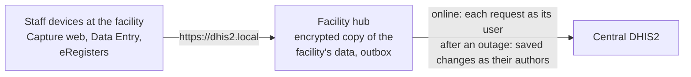

# Facility hub: overview

What the facility hub is, how it works, how it would be rolled out, how it protects data, and what is still open. This overview is for people who decide whether and how to pilot the hub, and for implementers who need the whole picture before the details. The full design is in [ARCHITECTURE.md](ARCHITECTURE.md), [DEPLOYMENT.md](DEPLOYMENT.md), [OPERATIONS.md](OPERATIONS.md) and [SECURITY-DESIGN.md](SECURITY-DESIGN.md).

**Status: a prototype.** This describes release v0.2.0 (23 November 2026), for DHIS2 2.42 and 2.43. The hub is a proof of concept. It has been tested on Raspberry Pis, Windows virtual machines and test servers with country data, but no facility runs it. Do not use it with production data or let patient care depend on it.

## The problem

At many facilities the internet is slow, or down for hours or days. DHIS2's apps cope with this in different ways:

- **Android Capture** works offline, but each tablet keeps its own copy. A patient registered at reception on one tablet does not appear on the lab's tablet until both have synced with central, and that needs the internet.
- **The web apps** (Capture web, the Aggregate Data Entry app, eRegisters) have limited offline support, kept in each browser. Work saved on one computer is not seen on another until it reaches central, and much needs central itself. When the line drops, staff often go back to paper.
- **Aggregate data entry on a shared computer** queues offline values in the browser, not per user. The next person to go online sends the previous user's values as their own.

Where patients pass between staff on different devices during one visit (reception, consultation, lab, pharmacy, maternity), an outage breaks the work, even though everyone is in the same building.

## What the hub is

The facility hub is a small computer on the facility's local network that stands in for central DHIS2. It is one program, which runs on a Raspberry Pi kit or as a service on a Windows PC the facility already has.

- **While central is reachable**, the hub passes each request through to central as the user who made it, and keeps a copy of what it sees.
- **When the internet drops**, the hub answers from its own encrypted copy of the facility's data. Staff keep working in the same apps, and see each other's work at once.
- **When the internet comes back**, the hub sends the changes made offline to central, in order, each as its author. Central checks them by its own rules, as if the staff had been online.

The apps do not change. Staff open `https://dhis2.local` in the browser instead of central's address, and use Capture web, the Aggregate Data Entry app and eRegisters as before.

The hub makes two promises:

1. **No data is lost.** A save the hub has confirmed reaches central as its author, even after a power cut, a dead disk or a long outage.
2. **No data is stolen.** A hub, disk or USB stick that leaves the facility gives up no patient data without a staff password. No user sees through the hub what central would not show them.

The design follows a few principles:

- **Central stays the source of truth.** The hub never owns metadata or decides access. It can be wiped or replaced once its saved changes have reached central.
- **One image for every country.** Every hub starts from the same software. It learns its facility, programmes and users from central at set-up, so any box can go to any facility, and a spare can replace any hub.
- **No IT staff at the facility.** Facility staff set the hub up with an installation card. Everything else is done from central.
- **Fail closed.** When the hub cannot decide something exactly as central would, it answers "needs connection" instead of guessing.
- **A hub only where it is needed.** Most small facilities do not need one.

## Which facilities get a hub

Give a facility a hub when most of these hold:

- patients pass between staff on different devices during a visit;
- staff work in the browser and must keep working during outages;
- outages are frequent or long;
- the facility is big enough that registering a patient twice is a real risk.

Where one or two staff each capture their own patients on their own tablet, Android Capture works offline on its own and is enough. The national team chooses hub facilities with the districts, and reviews the choice yearly.

## What works offline

Offline, the hub answers the requests it can answer exactly as central would. Staff can:

- log in, if they have logged in once through the hub while online;
- search for people registered at the facility, open them, and use working lists;
- register people, enrol them, and add and edit events and notes;
- capture event programmes (without registration);
- enter aggregate data in the current period and recent open periods, in forms the hub has stored;
- get generated IDs (such as unique patient numbers) from a pool the hub reserves on central in advance.

Some things always need a connection:

- deleting records;
- images and files (Capture web saves the form without them);
- validation rules run on the server;
- searches beyond the facility, and patients owned by other facilities;
- a screen nobody at the facility has opened online through the hub in the last 14 days.

The full list per app is in [SUPPORTED.md](SUPPORTED.md). In Capture web, "needs connection" shows as "An unknown error occurred (503)". Training must cover this.

**Android Capture is on hold.** The stock Android app does not trust the hub's certificate (see "Reaching the hub securely" below). Pilot facilities therefore work in the browser only. A fix needs work in the Android app, by the Android team.

**Optional: answering from the hub while online.** Where the uplink is slow, a country can list programmes that the hub answers from its own copy even while central is reachable. Saves still go to central at once. At 31 KB/s with a 1 second delay per request, Capture's dashboard went from 4.4 s to 0.12 s, and its start from 19 s to 4.8 s. It is off by default.

## How data moves

**As each user, never as a shared account.** Every request reaches central with the user's own personal access token, made at their first online login through the hub. Central's audit log and access rules therefore apply to every change. Accounts that can manage users on central (superusers and similar) pass through online only: the hub stores no token for them.

**Who sees what.** The hub has no sharing rules of its own. It remembers, per user, which records central showed that user, and shows them the same offline. Automated tests run the same queries against real DHIS2 and against the hub, for many users, on three data sets (synthetic, Sierra Leone and Laos) and both DHIS2 versions. They found no case of the hub showing more than central.

**Sync.** Every 15 minutes, the hub:

1. sends the changes saved offline, in the order they were made, each with its author's token;
2. fetches what changed on central for the facility, once per group of users with the same access.

At a busy health centre (300,000 people), the first full download takes about 15 minutes on a Pi 5 for 60 users. After that, the hub makes about 9,400 requests a day to central. With Capture web, a hub that passes everything through lowered central's database time for the facility from 82.5 s to 51.5 s a day.

**After an outage.** The hub waits a random time of up to five minutes before it sends, so hundreds of hubs do not reach central in the same second after a national outage. A busy day offline, about 3,000 saves, takes about 7 minutes to send over 4G.

**Refused changes.** Central can refuse a change the hub accepted offline, for example after a metadata change. The change then stays on the hub, so staff still see what they entered, and the hub reports it on central with the error code and every value masked. Staff see their own refused changes on the hub's page. A hub manager can fix central and resend a whole group of refused changes on all hubs at once, or discard them. Neither Capture app shows a change refused after the save, so training must cover the hub's page.

**Edits on both sides.** If a record is edited at the facility while the hub is offline, and also on central, the edit that reaches central last wins, and nobody is told. Android Capture on its own does the same. The hub counts these cases and the Facility Hub app shows them, so the pilot shows how common they are. Staff and districts should not edit a facility's records on central while its hub is offline.

## Hardware and platforms

**A Raspberry Pi kit**, assembled and flashed at a central depot, costs about USD 150 to 220:

| Part | Choice |
|---|---|
| Board | Raspberry Pi 5 with 4 GB (a Pi 4 for smaller facilities) |
| Storage | 128 GB NVMe SSD, not an SD card, which wears out and corrupts on power loss |
| Clock | The Pi 5's real-time clock with its battery (an add-on module on a Pi 4): the hub needs the right time after a power cut with no internet |
| USB stick | An industrial stick that stays in the box. It carries the setup code, then a copy of every unsent save, updated each minute |
| Power | The official supply, on a UPS |
| Case | Wall-mountable, cooled |
| Optional | A TPM board (about USD 25), which makes a stolen disk useless on its own |

The hub itself needs a few hundred MB of memory. The rest of the memory caches the data, which takes about 6 to 7 GB at a busy health centre.

**A Windows PC the facility already has.** The same hub runs as a Windows service, installed by an administrator with one installer. It needs no new hardware, which is why the pilot is likely to include more Windows PCs than Pi kits. The PC must stay on while staff work, must not sleep, and is better not used for email and browsing. Windows 11 is supported. Windows has run on virtual machines only, not on a real facility PC.

The installer must be signed with a code-signing certificate before a country can install it from a release. There is no certificate yet, so v0.2.0 has no Windows installer attached.

**A Mac**, for the DHIS2 team to try the hub. Not for facilities.

## Rolling it out

### Who does what

| Who | What |
|---|---|
| National DHIS2 team | Plans the rollout and chooses hub facilities with the districts. On central: installs the Facility Hub app, protects the hub's settings, chooses the hub version, watches every hub, follows up refused changes. Trains district officers and facility focal points. |
| MoH IT | Buys and prepares Pi kits at a depot, keeps spares, installs the Windows service on chosen PCs. |
| District | Proposes hub facilities, delivers kits, helps facilities by phone, follows up refused changes. Not needed on site. |
| Facility | A focal point sets the hub up with the installation card. Every staff member logs in once online and moves their devices to the hub. Staff keep the hub powered and log in after a restart. |
| Software supplier | Publishes signed releases (the Pi image, the Windows installer, the Facility Hub app), tested against the DHIS2 versions they support. |

### Before the first hub

On central, once:

1. Install the Facility Hub app.
2. Name, in the app's settings, the user groups for hub owners (who may set hubs up), hub accounts and hub managers.
3. Set central's server time zone to the facilities' own. DHIS2 judges "future" dates by central's date, so with central in a zone to the west, registrations dated today are refused every night, for as many hours as the zones differ.
4. Check the patterns of generated IDs. A short pattern, such as three random digits per facility, has too few values for a hub's reserved pool.
5. Agree with the country's data protection lead what staff details reach central. Hubs write the record IDs and DHIS2 usernames of refused changes to central, without values, and every reader of those entries sees every hub's.

### At the depot

Flash the same image onto every SSD, assemble the kits, power each one on once, and stick on a label with the hub ID and `dhis2.local`. At first boot the hub writes its setup code to the USB stick in the box. Nobody needs to keep a list of codes: whoever holds the box has the code. No facility is assigned at the depot.

### At the facility

Facility staff set the hub up in about an hour, with no visit from the district:

1. Mount the hub near the router, and plug in power and the network cable.
2. On a laptop or phone on the facility network, open the address on the label. Type central's address from the installation card, and the setup code from the USB stick. Reading the stick needs a laptop, or a phone with a USB adapter.
3. The focal point logs in with their own DHIS2 account. The hub finds the facility among their organisation units and registers itself on central.
4. Every staff member logs in once through the hub while it is online. The hub then downloads what that person may see. Each staff member opens their working lists and forms once, online, so the hub keeps those screens for offline use.
5. Move the devices to the hub (below).
6. Test offline: unplug the internet, register a test patient on one device, and find them on another.

### Networks

The hub works on four kinds of facility network, chosen at set-up:

- **A. The facility's own router with Wi-Fi** (most common). The hub plugs into the router. Check that the router does not isolate Wi-Fi devices from each other.
- **B. A 4G MiFi as the only network.** The hub joins the MiFi's Wi-Fi.
- **C. No usable local network.** The hub becomes the facility's Wi-Fi, with its own password, and uses a cable or a USB 4G modem as its uplink. This is the most robust case. The Pi's own Wi-Fi serves about 10 to 15 devices; beyond that, add an access point.
- **D. Networks managed by hospital or NGO IT.** The hub needs outgoing HTTPS to central and GitHub, and may need a proxy.

A Pi without a cable network starts a setup Wi-Fi, so staff can choose among A to C from a phone. Cases B and C, the setup Wi-Fi and USB modems have not been tested on site.

Nothing on the internet needs to reach the hub. All its connections to central are outgoing, so it works behind 4G providers' address translation.

### Reaching the hub securely

Every connection to the hub is encrypted, on the facility network too. Staff must never learn to click through certificate warnings, and browsers refuse offline apps on a certificate they do not trust.

So the hub runs its own certificate authority, and each device installs it once. The hub's start page at `http://dhis2.local` guides staff through it, for Android, iPhone and iPad, Windows and macOS. It takes about a minute per device. Android asks for a screen lock first, and on personal phones the step is hardest. Managed devices can get the certificate from their device management system. The authority can only vouch for the hub's own names and private addresses, so installing it cannot expose any other site.

Devices then use `https://dhis2.local`, which follows the hub when its IP address changes. Where the network blocks that name, devices use the hub's IP address, and the router needs a fixed address for the hub.

### Moving devices to the hub

- Before switching, sync each device with central while online, so nothing is stranded under the old address.
- Replace the central bookmark with the hub's address.
- Training point: "At this facility, always open DHIS2 through the hub." Work done directly on central reaches the hub only at its next sync.
- Training point: photos and documents need the internet.
- A tablet that moves between facilities, such as a community health worker's, keeps central as its server. A hub serves one facility only.

### Rollout phases

| Phase | Hubs | Goal |
|---|---|---|
| National preparation | None, or one test facility | Central set up, kits and installer ready, trainers trained |
| Pilot | 5 to 10 facilities in one district, chosen for poor connectivity | Staff set hubs up from the card alone. Check the network cases, training and offline work with real patients. Measure sync volumes and power problems |
| Expansion | About 50, across 3 to 5 districts | Check depot logistics, delivery, the Facility Hub app and staged upgrades |
| National | Hundreds | District by district |

## Running the hubs

The national team and districts run the hubs from central, in the **Facility Hub app**. Every hub reports once an hour: its version, when it last sent and fetched data, what waits to be sent, refused changes, free disk, and 90 days of daily history (time offline, saves made online and offline). The app flags:

- a hub silent for more than 2 days;
- saved changes waiting for more than a day;
- refused changes, grouped by programme and error code;
- low disk, failed upgrades, and a hub that needs a newer release for central's DHIS2 version.

**Each hub has its own account on central** for this housekeeping, so it does not depend on the staff member who set it up. A hub manager approves it in the app with a 16-character code, read out by phone from the hub's page. The manager calls the facility on a number they already have.

**Upgrades.** The country chooses the hub version in the app and stages it: 5 pilot hubs, then 10 %, 50 % and 100 %. Each hub downloads the release, checks its signature, sends its waiting changes, upgrades a copy of its data, and rolls back by itself if the new version does not start properly. An upgrade loses no saved change. Before central moves to a new DHIS2 version, roll out a hub release that supports it.

**Support.** Districts support facilities by phone, from what the app shows. Facility staff only restart the hub, log in to unlock it, and plug in a replacement. There is no remote access to hubs. Most faults are fixed by moving the disk to a new board, or by sending a spare: keep one per district. A hub with a dead disk is restored from its USB stick, losing at most the last minute of saves.

**After a restart**, the hub stays locked until a staff member who used it before logs in. Until then, nothing is sent. A UPS makes night-time restarts rarer.

## Security in brief

- **Encrypted at rest.** Everything about patients is encrypted on the hub's disk. The key exists only in memory, after a staff login. A hub that restarts is locked until someone logs in.
- **A TPM where there is one.** On a Pi with a TPM board, or a PC with a TPM, a disk taken without its TPM gives nothing at all. A TPM is recommended for a national rollout, but not required.
- **Encrypted on the network**, with the hub's own certificate authority, limited to the hub's own names.
- **Signed releases.** A hub installs only releases signed with the supplier's key.
- **Signed instructions.** Settings and instructions on central (resends, version choices, moves of central) carry a code per hub. A hub ignores any it cannot verify, so another DHIS2 user cannot forge them.
- **Login attempts are throttled**, per user, per device and both, over the network and offline.
- **No patient values leave in reports or logs.** Refused changes and logs carry codes and IDs only.

The main limits:

- **The weakest staff password sets the bar** for a stolen disk without a TPM. Whoever holds the disk can guess passwords offline. Enforce central's password policy for hub users.
- **A running hub holds everything.** Once someone logs in, the whole facility's data is decrypted in memory.
- **A staff account obtained another way** (a password shared, written down or phished) is the more likely route to the data. Encryption on the hub does nothing against it.
- **Without a TPM, a stolen disk lets someone pose as the hub** to the devices at that facility. The hub is then retired, and its devices remove its certificate.

## What has been tested

- **Seven reviews** from October to November 2026, including two external critical reviews and an independent review with black-box tests. Their findings are fixed, with tests, or listed in [PENDING.md](PENDING.md).
- **Comparison with real DHIS2.** Automated tests send the same reads and writes to DHIS2 2.42 and 2.43 directly and through the hub, on synthetic, Sierra Leone and Laos data. The hub never accepted a save central would refuse, and never showed a user more than central would.
- **Power cuts.** On a Windows virtual machine, 10 cuts during continuous saving lost none of 9,759 confirmed saves. On a Pi 4's SD card, ten cuts over three days left none of 220,211 confirmed saves partial or wrong on central. The 1,753 not on central were registrations central refused for its own date reasons, and events held behind them.
- **Hardware.** Set-up, offline login after a power cut, and sending afterwards on a Pi 4; restoring a Pi 5's USB stick on a Pi 4.
- **Windows** on two virtual machines: installer, service, upgrades, power cuts and a virtual TPM.

Not tested yet:

- a real facility, with real staff and patients;
- a real Windows PC, and a TPM on real hardware;
- the setup Wi-Fi, MiFi and USB modems on site (network cases B and C);
- a long run of the v0.2.0 image on a Pi.

## What is open

Before a pilot:

- **Which platforms the pilot uses.** At least one Pi and one Windows PC, probably more Windows. Not yet chosen.
- **A Windows code-signing certificate.** Who buys and holds it is open. It costs from about USD 10 a month through a cloud signing service.
- **A real Windows PC and the TPM on real hardware** (above).
- **Swap on the Pi.** Raspberry Pi OS may write the hub's memory to disk unencrypted. Check and turn it off in the image.
- **Who may reset or move a hub.** Today any staff member assigned to the facility can. Whether that needs a stricter role is not decided.
- **Data protection sign-off** on what staff details reach central.
- **The pilot district and facilities**, a password policy, the installation card, training and a support line.

After a pilot, from what it shows:

- whether offline edits that replace newer changes on central are common enough to hold them back;
- whether Android Capture should come back, which needs the Android team;
- whether the hub needs any of the hardware options recorded in [design/deployment-options.md](design/deployment-options.md).

The full list is in [PENDING.md](PENDING.md).

**Who maintains it.** The HISP Centre implementation team maintains the hub today. The documents call the role that publishes releases and tests new DHIS2 versions "the software supplier". Who takes that role for a national rollout, and who pays for kits, spares, the code-signing certificate and support, is not yet written down. A country needs no programmers: it needs a national DHIS2 team that can run the Facility Hub app, MoH IT staff who can prepare kits or install the Windows service, and district staff who can support facilities by phone.

## Further reading

| Document | For |
|---|---|
| [DEPLOYMENT.md](DEPLOYMENT.md) | The rollout proposal: hardware, set-up, networks, devices |
| [OPERATIONS.md](OPERATIONS.md) | Running hubs: monitoring, refused changes, upgrades, security operations |
| [SECURITY-DESIGN.md](SECURITY-DESIGN.md) | The threat model, each defence, and the known gaps |
| [ARCHITECTURE.md](ARCHITECTURE.md) | How the hub works inside, for developers |
| [SUPPORTED.md](SUPPORTED.md) | What works offline, per app |
| [FACILITY-HUB-APP.md](FACILITY-HUB-APP.md) | The Facility Hub app on central |
| [RECOVERY.md](RECOVERY.md) | Backup, the USB stick, and what a lost hub costs |
| [PENDING.md](PENDING.md) | Everything that is open |
| [FINDINGS.md](FINDINGS.md) | What building the hub taught us about DHIS2 |
