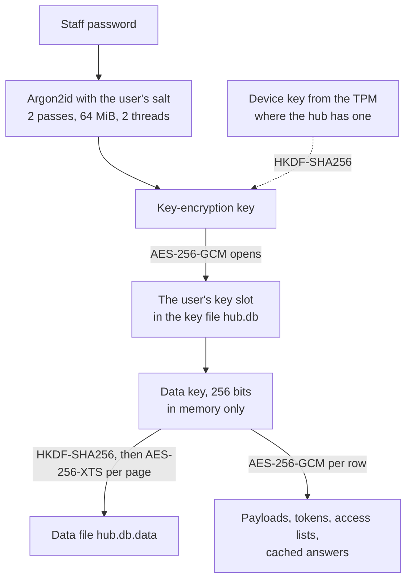

# Facility hub: security design

How the hub protects the data it holds and the data it sends: the threats it answers, how each defence works, and what is still open. Checked against the code on 27 November 2026 (v0.2.0).

The hub makes two promises. First, no data is lost: a save it has confirmed reaches central as its author, even after a power cut, a dead disk or a long outage. Second, no data is stolen: a hub, disk or USB stick that leaves the facility gives up no patient data without a staff password. Nor does any user see through the hub what central would not show them.

The main limits come first:

- The weakest staff password sets the bar for a stolen disk.
- Once someone logs in, the whole facility's data is decrypted in the hub's memory, so a running hub is the most valuable target.
- Without a TPM, a stolen disk also lets someone pose as the hub to the devices that trust it.
- A staff account obtained by other means (a password shared, written down or phished) is the more likely way to the data. Encryption on the hub does nothing against it.

This document describes `main` at release v0.2.0 (23 November 2026). The hub is a proof of concept: no facility runs it yet. What is still open is under "Known gaps and residual risks" and, in full, in [PENDING.md](PENDING.md). How data moves through the hub is in [ARCHITECTURE.md](ARCHITECTURE.md).

## Threat model

Each row is a threat the design answers, with the defence and where it is tested. The sections below explain each defence.

| Threat | Defence | Tested by |
| --- | --- | --- |
| Disk or hub stolen while powered off | Everything but the key file, the public file and a few small files is encrypted (AES-256-XTS file, AES-256-GCM rows). The data key exists only in memory after a staff login | `TestAcceptance` scans the store files for plaintext |
| Offline password guessing on a stolen disk | Argon2id per key slot (about 0.3 s on a Pi 4). Slots of users absent 90 days are removed. With a TPM, slots are bound to the device | `internal/hubcrypto` and `internal/devkey` unit tests, `TestDeviceKeyProtectsTheDisk` |
| Staff member sees records central would not show them | Visibility per user from central's own listings. Local records by program, stage and scope rules. Searches filter and sort only on attributes the user may read (R-03) | Live read oracles: no LEAK on 3 profiles, on 2.42 and 2.43. `TestSearchesUseOnlyReadableAttributes` |
| One user's metadata served to another | Cached answers are per user. Only app files, login configuration, static content and locales are shared, never metadata. Request paths that are not clean are refused (R-16, R-18) | `TestPerUserMetadataNotShared`, `TestCleanPath` |
| Someone on the Wi-Fi reads traffic | HTTPS only, from the hub's own certificate authority. HSTS for 7 days | `internal/e2e/certificate_test.go` |
| A fake hub on the network | Devices trust only this hub's authority, name-constrained to its names and private addresses | `TestAuthorityIsConstrained`, `TestAuthorityOnlyForServers` |
| Password guessing over the network | Throttle per user and device, per device, and per user. An attempt counts before the password is checked (R-04). Same answer for an unknown user and a wrong password | `internal/e2e/security_test.go`, `TestLoginThrottleParallel` |
| Someone sets up a hub for the wrong central or facility | 8-digit setup code from the box's USB stick, also for a restore from the stick (R-15). Central's address from the installation card, https with a trusted certificate. Facility from the logged-in user's org units | `TestSetupCentralURL`, `TestStickRestoreChecksCodeAndCentral` |
| A hub pointed at a hostile server later | The hub moves only when the current central vouches: an announcement signed with the hub's move key, an https redirect, or a move code | `internal/e2e/move_test.go`, `TestSignedInstructions`, `TestCentralMoveSendsNothingToAForgedAddress` |
| A forged registry or admin entry on central | Approved hubs act on dataStore instructions only with a code made with their own move key. Unsigned entries are ignored and flagged. Each hub protects its registry entry | `TestSignedInstructions`, `TestSignedRevocation`, `TestHeartbeatReportsUnsignedEntries`. Revoke checked on 2.42.7.1 and 2.43.2.1 |
| A forged release | ed25519-signed manifest and SHA-256 per binary, checked before anything is parsed. The signing key is read only for a tag push, behind a GitHub environment with reviewers (R-08) | `internal/upgrade` tests |
| Patient values leaking to central's dataStore or to logs | Issues carry codes and UIDs, with values replaced by `***`. Logs keep path templates and parameter names only. Transport errors name the URL without its query (R-44) | `TestAggregateRefusalHidesValues` |
| A save lost to a power cut | Both store files are synced at every commit, before the hub confirms the save | Windows: 10 cuts, 9 759 saves, none lost ([PERFORMANCE.md](PERFORMANCE.md)) |
| A dead disk | Sealed copy of pending saves and keys on the USB stick each minute. Restore with a staff password | `internal/e2e/stick_test.go` |
| A save sent as the wrong user | Outbox entries carry their author and are pushed with that user's own token | `TestAcceptance` (spec scenario 3), `TestAggregateOfflineAttribution` |
| A crafted tracker payload from a logged-in client | Input is checked at the boundary: relationship ends are of the kind they name, hub-owned fields are kept, no update moves a record to another person, program, stage or enrollment, and dry runs are not stored (R-01, R-02, R-10, R-11) | `internal/tracker/input_test.go`, `FuzzFilters`, `FuzzParseFields` |
| Requests without a login that run a hub out of memory | Request log capped at 4 000 keys. At most 64 KiB of headers per request, and 64 KiB of body without a login. Tracker imports at most 16 MB | `TestRequestLogIsCapped` |
| A token stored on the hub that can manage users on central | Accounts with user-management authorities (`ALL`, `F_USER_ADD` and similar) get no key slot and no token. They pass through online only (R-25) | `TestUserAdminsNotRegistered` |

## Encryption at rest

Nothing about a patient can be read from the disk without a staff password. Patient data is never written unencrypted.

One random 256-bit data key per hub encrypts everything sensitive, and it is never stored unwrapped (`internal/hubcrypto`). Each user who has logged in online holds a key slot: the same data key, wrapped with AES-256-GCM under a key derived from their password with Argon2id (2 passes, 64 MiB, 2 threads, a salt per user; about 0.3 s on a Pi 4). The slot itself checks the password, so the hub keeps no password hashes. At most two derivations run at once, so a burst of logins or guesses cannot use up the hub's memory.

The store has three files (`internal/store`):

- **The key file** `hub.db` is plaintext, because it is read while the store is locked. It holds the hub ID, mode, central URL and proxy, and each user's username and key slot.
- **The data file** `hub.db.data` is encrypted page by page with AES-256-XTS, under a 64-byte key derived from the data key with HKDF-SHA256. Its WAL, journal and temporary files go through the same layer.
- **The public file** `hub.db.public` (since 13 November 2026) holds in plain text what central gives anyone without a login: the login page's files, its settings and its images. The hub needs them while the store is locked, because staff unlock it by logging in through that page. It holds at most 16 MB, and the oldest copies go first.

The whole data file is encrypted because much of what matters lies outside the payloads: which patients are enrolled in which program, their visit dates, which staff see whom, and pages SQLite has freed. On top of that, payloads, tokens, access lists, cached answers, outbox entries and errors are sealed per row with AES-256-GCM. Each row's associated data binds the ciphertext to that row, so rows cannot be swapped.

### Locked at every start

After a restart, the data key exists nowhere until a known user logs in, from any client. Android's background sync sends stored credentials with every request, so a facility with Android devices unlocks without anyone doing anything. The key then stays in memory until the hub stops. Unlocks run one at a time, and a login that comes during one waits for it, so no save reaches an index not yet loaded.

The login page comes from the public file. Until 13 November 2026 it was in the encrypted store: after a restart without internet a browser could not load it, so at a web-only facility nobody could log in and unlock the hub ([FINDINGS.md](FINDINGS.md), "The demo of 13 November 2026").

Unlocking without a person, with a key available at boot, was decided against on 20 October 2026: it would hand the data to whoever takes the whole device ([RECOVERY.md](RECOVERY.md), option I).

A key slot checks the password that was current when the slot was written. The hub replaces a slot only when its user logs in online. So after a password change on central, the old password still unlocks the hub offline until that user logs in online ([RECOVERY.md](RECOVERY.md), "Notes against the current hub").

### The TPM

Where the machine has a TPM 2.0 (`internal/devkey`), the hub seals a device key in it: 32 random bytes, kept sealed as `device.key` in the data folder. The device key is mixed into every key slot on the disk, and it seals the TLS keys, the setup code and the Wi-Fi files. A disk taken without its TPM then allows neither password guessing nor posing as the hub. The device key never unlocks the hub: that still takes a staff login.

A TPM is recommended and used where there is one, but not required (decided 17 November 2026). Pi kits without a board and PCs without a TPM are supported. `tpm: false` in `hub.yaml` turns it off. The heartbeat says whether a hub's keys are sealed (`deviceKey`), and the Facility Hub app shows it on the hub's page.

- **On a Pi** the TPM is an add-on board (Infineon SLB 9670 on SPI, about USD 25), which the image enables.
- **On Windows** the hub uses the PC's own TPM. Windows 11 requires TPM 2.0, so most PCs sold with it have one. The installer's last page and `install.log` say when the PC has no usable TPM.

Three limits ([DEPLOYMENT.md](DEPLOYMENT.md), section 2, "What is not encrypted"):

- A stolen whole device, board and TPM together, is not protected. The key has no PCR policy: the Pi has no measured boot, and on Windows a firmware update would lock the hub out.
- The USB stick keeps slots that open with the password alone, so the hub can be restored on new hardware.
- A dead TPM, or a disk moved to another machine, cannot be opened. The hub says so on its start page and is restored from its stick onto an empty disk.

What has run: the code is tested against a software TPM. On a Windows 11 VM with a virtual TPM (19 to 22 November 2026), sealed, removed, restored, none and added later all behaved as designed. It has not run on a TPM board on a Pi, nor on a real PC's own TPM ([PENDING.md](PENDING.md), items 4 and 15).

### What is not encrypted

These files in the data folder are plaintext, readable only by the hub's service account (and root or administrators). On a Pi the unit makes the data folder 0700 and the hub writes its files 0600 (R-26). A hub keeps the unit of the image it was flashed with, since self-upgrade replaces only the binary. On Windows the installer limits the folder to the service account, administrators and SYSTEM.

| File | Why it is plaintext | With a TPM |
| --- | --- | --- |
| Key file `hub.db`: hub ID, mode, central URL, proxy, usernames, key slots | Read before anyone logs in | Slots bound to the device key |
| `tls.key`, `ca.key` | The hub serves HTTPS and renews its certificate before anyone logs in | Sealed |
| `hub.db.public`: the login page's files, settings and images | Central gives them to anyone, and the hub serves the login page before anyone logs in. At most 16 MB. Not copied to the stick | Same |
| `setup-token` (before set-up) | Checked before any user exists | Sealed |
| `setup-wifi`, `facility-wifi`, `network.json` (Pi) | The Wi-Fi starts before anyone logs in. NetworkManager keeps its own copy of each Wi-Fi password, readable by root only | Sealed |
| Logs | Path templates and parameter names only, no values or UIDs. With `log_requests` on (off by default) the request log also gets parameter names, not values | Same |

The hub's own account password, the move key and the users' tokens are inside the encrypted state.

AES-XTS keeps the data file confidential, but it does not detect tampering outside the sealed rows: someone with write access to the disk can corrupt it. In memory, decrypted pages sit in SQLite's page cache, with up to 4 096 decoded payloads in the hub's own cache. Both are dropped when the store locks. A failed backup's error does not carry the data key (R-24).

On the Pi the service unit turns core dumps off (`LimitCORE=0`). It also sets `MemorySwapMax=0`, but that does not hold: the Raspberry Pi kernel gives the hub's cgroup no swap control (seen on a Pi 4, 16 November 2026). Raspberry Pi OS runs zram swap, and what looks like zram's writeback to a file on the disk. A writeback would put pages of the hub's memory, the data key among them, on the disk unencrypted. This is open ([PENDING.md](PENDING.md), item 26).

## Who sees what

Through the hub, each user sees what central shows them and no more. For central's records the hub has no sharing rules of its own: it remembers central's answer per user.

A user sees a record from central offline only if central listed it to that user, or to users with exactly the same access in one shared listing. The hub keeps this as a bitmap per user. A full pull, weekly or after a user's access changes, removes what central no longer lists.

- A person transferred out of the facility is hidden from everyone offline. One transferred back on central shows again at the next ownership check, at most an hour later.
- An event of a tracker program counts as the facility's only when its enrollment does.
- The facility's org unit path is read again at the hourly catalog refresh, so a facility moved to another district leaves the old district officer's view.
- An enrollment read online through temporary ownership ("break the glass") is not kept.

Records written at the hub, before central has them, follow a short local rule. The user needs read access to the program, stage and tracked entity type, the facility in their search scope, and read access to the record's option combinations. A record the hub lacks and one the user may not see get the same answer, so a guessed UID reveals nothing.

Searches filter and sort only on attributes the user may read (R-03, fixed 10 November 2026). Before, a user could learn values from a program they cannot read. Without read access to a program's tracked entity type, the hub hides its enrollments and events and refuses writes, as central does.

The live read oracles test this against DHIS2 ([TESTING.md](TESTING.md)). They run the same queries against real DHIS2 and the hub, for many users, and compare the answers. On 2.42 and 2.43, across the synthetic, Sierra Leone and Laos profiles, they found no LEAK (the hub showing more) and no DIFFERS. Twin users in the access matrix check that shared listings group only users central treats the same. The oracle also filters and sorts each program's lists on other programs' attributes, and holds each user's matches and refusals to a baseline per profile and DHIS2 version. Baselines exist for all three profiles on both versions (`internal/live/testdata/oracle`, since 19 November 2026).

One case is accepted (28 October 2026). A person owned elsewhere, opened offline by UID with a protected program, gets only what central shows the same user without the program: the person-type attributes and no enrollment. The oracle counts it as accepted, not as a leak (`shownWithoutProgram`).

Cached answers are strictly per user. Only what holds no user data, and is the same for everyone, may be served offline from another user's copy: app files, the login page configuration, static content and locales. Metadata never is, because DHIS2 sharing can differ per user for any metadata object (`TestPerUserMetadataNotShared`). Neither are `/api/me`, user settings, the org unit list, working lists or tracked entity filters. More rules:

- Without a session, the hub caches only the login page's files and shared settings, never with a query string, and the apps menu counts as per user (R-16, R-18).
- Validation answers are never cached. Offline they get "needs connection", so an offline edit is never shown an older result.
- Generated values are never cached or replayed. Offline they come from the hub's reserved pool ([FINDINGS.md](FINDINGS.md), "Found by adversarial testing", item 46).
- `/api/system/info` is served offline from the hub's own copy, to a logged-in user with no copy of their own. The hub reads it each cycle with its own token and cuts it to the fields central gives any user who is not a superuser. None of them is about a user. It is never served before a login, and never from the public file ([FINDINGS.md](FINDINGS.md), item 39).
- At an online browser login the hub loads, with that user's own token, the screens the facility's apps requested in the last 14 days (at most 300, once a day), so each user gets their own copy. It never loads data, generated values, validation or requests naming another user.

### Logins and sessions

Only users who logged in to this hub online before, while assigned to its facility, have a key slot. A user without the facility in their scope passes through online, but gets nothing offline (`TestOutsiderNotRegistered`). An account that can manage users on central (`ALL`, `F_USER_ADD` and similar authorities) also gets no key slot and no stored token, and passes through online only: a stolen token of such an account could make or take over other accounts (R-25).

Central's decisions reach the hub within minutes: Basic credentials are checked again every 5 minutes, and a user central refuses is marked "needs online login". Through a token it takes longer. Central caches a token's login, with the user's access as it was, for an hour (measured on 2.42.7), and the hub refreshes access hourly. An access change on central therefore reaches the hub within about two hours. This was accepted. Deleting the user's tokens on central ends it at once.

Do not reuse usernames on central. A hub knows its users by username, so a new account with a deleted account's username inherits its place on the hub once it logs in there (R-40; [DEPLOYMENT.md](DEPLOYMENT.md), "Security operations").

Sessions use HttpOnly, SameSite=Lax cookies, and end after 1 hour idle or 12 hours at most. Hub pages send `nosniff`, `X-Frame-Options: DENY`, `Referrer-Policy: no-referrer` and a strict content security policy. Posts to the setup, login and admin pages must come from the hub's own origin, scheme included, and logout takes a POST only (R-35, R-36).

Failed logins count per user and device (5), per device (20) and per user across devices (50) (`internal/auth/throttle.go`).

- Each attempt is counted before the password is checked, so parallel guesses cannot all pass the counters (R-04).
- A counter is forgotten only after 15 quiet minutes since its last failure, not its first, so steady guessing below a limit still adds up.
- Past a limit, the wait starts at 30 seconds and doubles up to 15 minutes.
- A success clears only that user's counter on that device, so one working account cannot reset the device's count and keep guessing others.
- Offline, each guess costs an Argon2id derivation, and only two run at once.
- During a lockout, a cached Basic credential passes only from the address it was verified from. From any other address the right password gets 429 like a wrong one.
- A wrong Basic password that the hub never saw succeed does not end the user's sessions or block their offline login (R-05).

A retired hub stops serving patient data, but keeps pushing what it holds (`TestRetiredHubStopsServing`). A hub is retired when another hub registers for its facility, or when its registry entry is removed. It refuses aggregate values offline too. An approved hub takes a "revoked" status in its registry entry only when it carries a valid code made with the hub's move key (R-23). A hub not yet approved takes the mark only once central refuses its own token, and drops it when the entry no longer says it.

The hub's page has one tier for all facility staff: anyone assigned to the facility can reset or move the hub and choose the USB stick. Only set-up and take-over need the hub owners group. Whether reset and move need a stricter tier is not decided ([PENDING.md](PENDING.md), item 38).

## On the network

Every connection to the hub is encrypted and authenticated, on the facility LAN too. Plain HTTP is ruled out, and so are certificate warnings that staff learn to click through. A clicked-through warning stops a listener, not someone posing as the hub. Browsers also refuse service workers, which offline apps need, on an untrusted certificate. The decision and the options not chosen are in [DEPLOYMENT.md](DEPLOYMENT.md), "Reaching the hub securely".

### The hub's certificate authority

Devices open `https://dhis2.local` and install the hub's own certificate authority once (`internal/hubtls`, decided 19 October 2026). With the guide on the hub's start page, that takes about a minute. The authority is limited so that installing it cannot expose anything else:

- It issues server certificates only: no code signing, mail or client certificates.
- Name constraints limit it to `dhis2.local`, `localhost`, the hub's host name, the names in `hub_hosts`, and private IP ranges, so it can never vouch for a public site.
- It cannot create intermediate authorities.

The authority lasts ten years. Server certificates last 397 days, inside Apple's limit of 825. The hub issues a new one when fewer than 60 days are left, or when its names or addresses change, which it checks every 30 seconds. Keys are ECDSA P-256, and the hub accepts TLS 1.2 and later.

The authority file is served at `http://dhis2.local/hub/ca.crt`. Someone on the Wi-Fi at the moment a device installs it could hand over their own file instead. That one-time window per device is accepted. A cautious installer compares the fingerprint on the start page with the one in the Facility Hub app, which comes from the hub's heartbeat over central's HTTPS.

Plain HTTP on port 80 serves only the start page and the authority file. The page tries `https://` in the background, and moves there once the device trusts the hub. HTTPS answers carry HSTS for seven days, so a device used weekly never meets a fake plain-HTTP page.

The authority's key sits next to the server's key, outside the encrypted store, because the hub issues certificates without anyone logging in. From a stolen disk without a TPM, it lets someone pose as `dhis2.local`, the hub's other names, and HTTPS on any private address, to the devices that installed this hub's authority. Such a hub is retired, and its devices remove its authority.

### Other defences

- **Host names.** The hub refuses `Host` headers that are not its own names or addresses, which defeats DNS rebinding. `hub_hosts: "*"` is refused at start.
- **Sizes.** A request without a login may carry at most 64 KiB of body, and any request at most 64 KiB of headers (R-06). A tracker import may carry at most 16 MB, and imports over 4 MB run one at a time. The request log keeps at most 4 000 keys, each part cut at 200 bytes.
- **Paths and headers.** Request paths that are not clean (double slashes, dot segments) are refused before routing (R-16). Clients' `X-Forwarded-*` and `Forwarded` headers are not passed to central (R-17).
- **The Pi image's firewall.** nftables lets in ports 80 and 443 and mDNS from private addresses only, plus DHCP and DNS on the hub's own Wi-Fi. There is no SSH, no console user and no remote access.
- **The Pi's service unit** (`deploy/hub.service`). The hub runs as its own user with `NoNewPrivileges`, `PrivateTmp`, `LimitCORE=0`, `UMask=0077`, a private data folder and `ProtectSystem=strict`. It writes only its data folder, its program folder, the USB stick and `/run/hub`. The root diagnostics job runs the hub binary as the hub user. Polkit allows the hub user only the four NetworkManager actions its `nmcli` calls need, and setting the time zone to central's. A root unit, not the hub, writes the setup Wi-Fi's captive DNS line. The checks of this hardening on a Pi have not been run ([PENDING.md](PENDING.md), item 6), and the swap limit does not hold (item 26).
- **Windows.** The installer installs for the whole PC only and needs administrator rights (decided 22 November 2026). The hub runs as a service under its own virtual account. The installer opens the hub's ports on every firewall profile, because facility networks are often marked "Public", and only for the local subnet. Set-up is allowed only from the PC itself (`setup_local_only`).

The Android Capture app is on hold, because it does not trust authorities installed on the device. Pilot facilities work in the browser. Pinning the hub's key in the app is the option kept in mind; that is work for the Android team.

### Setting up a hub

The setup page is the hub's front door before any user exists:

- **The setup code** has 8 digits and is written to the USB stick in the box (`facility-hub/hub.txt`, the line "Setup code:", removed at set-up). It proves the person holds the box. Wrong codes are throttled like logins, and across all devices together at 50. Someone who stops at 49 and waits out each 15-minute window gets about 4 700 guesses a day: an even chance takes about 29 years, 1 % about 7 months (R-04, R-29). A restore from the stick, and a network change before set-up, need the code too (R-15, R-29). Codes are compared in constant time.
- **Central's address** comes from the country's installation card: https with a publicly trusted certificate only, optionally limited by `central_hosts`. The login step uses only an address the server step checked.
- **The facility** is found among the logged-in user's own org units. Set-up and take-over need the hub owners group named in the Facility Hub app's Settings, which only superusers edit. Only its members may do them. A set-up cut short does not block later ones (R-09), and a form submitted twice runs it once (R-38).
- **The setup Wi-Fi** `Hub-<ID>` (a Pi without a cable network) uses WPA2 with an 8-digit password, on the stick in `hub.txt`. It guards only the temporary setup network. When the hub becomes the facility's Wi-Fi (case C), that network keeps the name and takes a password the hub makes: 4 groups of 4 characters, about 79 bits, kept as `facility-wifi`. It is shown on the admin page and in `hub.txt`. "New password" replaces it, and every device joins again.

## Accounts and tokens on central

Patient data goes to central only with each user's own personal access token (PAT). Central's audit and access rules therefore apply to every change, as if the user had been online.

A user's PAT is created at their online login and sealed in the data file. It lasts as long as the country's setting (7 to 365 days, default 90), and is renewed while online in the last week of its life. On 2.42.7, central keeps accepting a disabled user's PAT for up to an hour, since it caches token logins ([FINDINGS.md](FINDINGS.md), "Tokens outlive their user"). The hub therefore stops using a user central refuses, and the Facility Hub app revokes a lost hub's tokens. A reset of a hub deletes the users' tokens on central too, and the hub's folder on its stick (R-25).

The hub keeps no passwords to push with. Without a PAT, offline changes are refused, not queued (`password_fallback` is off by default).

### The hub's own account

The hub's own account (`internal/hubaccount`) does the housekeeping that must not depend on a staff member: heartbeat, issue reports, registry, reserved values and upgrade checks. It never carries patient data. Until the account is approved, the hub does its housekeeping with a token of whoever set it up.

1. At set-up, the hub asks for an account in its registry entry, with a public key only it can decrypt with. Its page shows a 16-character account code made from that key, its ID and its facility.
2. A hub manager, not necessarily a superuser, calls the facility on a number they already have. They ask for the code and enter it in the Facility Hub app, which refuses a code that does not match the key and facility in the entry. A request that will never be approved can be dismissed; a hub that is still running asks again.
3. The app creates the user `<hub ID>`, assigned to the hub's facility only, with a role that has no authorities. The credentials go into the registry entry, encrypted to the hub's key.
4. The hub checks the account: its own ID, its facility only, no authorities. It then changes the password, makes a new token, deletes the account's other tokens and clears the registry. Whoever saw the credentials on the way is shut out. If its token is deleted on central, the hub makes a new one at once with the account's password. If that fails, its admin page says housekeeping fails.

To revoke a hub, a hub manager uses Revoke in the Facility Hub app. It writes a signed "revoked" status in the registry entry, deletes the hub's tokens, then disables the user `<hub ID>` on central. Checked on 2.42.7.1 and 2.43.2.1 on 11 November 2026 with a hub manager's role: the hub's user can no longer log in. A revoked hub is not made active again; it is reset and approved again. The app asks for confirmation before a group Resend or Discard, the next rollout stage and a move announcement, and each dialog says how many hubs and saves it reaches (R-30).

### Central's dataStore

The namespaces must be protected before the first hub goes out ([DEPLOYMENT.md](DEPLOYMENT.md), "On central, before the first hub" and "Security operations"). By default any user can write a namespace, and a forged registry entry could retire a hub. Write access to the `facility-hub-*` namespaces goes only to the hub groups named in the Facility Hub app's Settings. `facility-hub-admin` (release, moves, resends) is writable by administrators only, and `facility-hub-keys` (move keys) is shared with hub managers only.

Sharing alone was not enough. On 2.42 any user may create a missing entry, own it and share it read-only for everyone else, and that passed the hubs' check of public access (R-07). So the Facility Hub app signs each instruction it writes, with a code per approved hub: the first 16 bytes of an HMAC-SHA256 made with that hub's move key, bound to the hub, the kind of instruction and its content ([the design](design/2026-11-11-signed-instructions.md), built 11 November 2026).

- An approved hub acts on `central-move`, `retries`, `release`, `accounts`, the `facility-hub-config` settings and a revocation in its registry entry only with a valid code for itself, no older than the last one it took of that kind.
- It ignores the rest, names them on its admin page and in its heartbeat (`unsigned`), and the app flags them (`TestSignedInstructions`, `TestHeartbeatReportsUnsignedEntries`).
- A hub not yet approved has no move key. It ignores `central-move`, `retries` and the settings, using the built-in defaults, and reads `release` and `accounts` on their sharing.
- A group Resend or Discard reaches only hubs under the org units of the manager who asked, and only saves refused before it.
- Retention and pool sizes are kept within the app's limits.

Sharing still protects the entries as before: each hub shares its own registry entry with the hub groups only, and the app creates the `facility-hub-admin` entries protected. Each hub checks the sharing of the entries it acts on, and lists those any user may write in its heartbeat (`unprotected`).

Two limits are accepted. The codes keep out other DHIS2 users, not hub managers: every hub manager reads every move key (accepted 19 October 2026), so any manager can sign anything for any hub. And a "retired" mark, written by the replacing hub at its set-up, stays unsigned: a forged one stops a hub serving offline until the entry says active again. The hub keeps its data and pushes its outbox.

**What staff details reach central.** Each hub writes to the `facility-hub-*` namespaces, for the Facility Hub app: each refused change with its record's ID and its author's DHIS2 username, and, while the overwrite count is on, the recent offline saves that replaced a newer change on central, with the record's ID, kind, programme, author and four times. No values. The entries are not shared by org unit: whoever can read the namespaces reads every hub's. Before a national rollout, the country's data protection lead signs off on this, and on who may read the namespaces ([DEPLOYMENT.md](DEPLOYMENT.md), "On central, before the first hub", step 5). The overwrite count can be turned off (`facility-hub-config/overwrites` = `{"off": true}`).

### Moving central

A central move cannot be used to collect credentials. The hub moves to a new address only when the current central vouches for it:

- a signed announcement in `facility-hub-admin`;
- a permanent redirect over verified https, three times in a row;
- or a 10-character move code, made from the hub's own move key, which the hub checks without sending anything.

An announced or redirected move also waits until the old address has been silent for an hour. An unsigned announcement is ignored, because checking the new address sends the hub's token.

### Releases

Hubs upgrade only to binaries that match an ed25519-signed manifest, which is verified before it is parsed (`internal/upgrade`). The source and the public key are built into the binary.

- The release signing key was made on 16 November 2026. v0.1.5 and v0.2.0 are signed releases.
- The key is a secret of a GitHub environment with required reviewers. Only the publish job of a `v*` tag push enters it, and the tag must be on the default branch, so a dry run cannot sign with the real key (R-08).
- Workflows are read-only by default and their actions are pinned by commit.
- How to rotate the key is in [DEPLOYMENT.md](DEPLOYMENT.md), section 2, "Release key rotation".
- A tagged release leaves the Windows installer out unless a real Authenticode certificate is set. No such certificate exists yet, so v0.2.0 has no Windows installer attached ([PENDING.md](PENDING.md), item 37).

## Not losing data

During an outage, the hub's outbox holds the only complete copy of what staff entered. The web apps keep nothing, and Android marks records synced once the hub accepts them. Three layers protect that copy. The options considered are in [RECOVERY.md](RECOVERY.md).

### Saves on disk

Both store files are synced at every commit, before the hub answers the client. What has been run:

- **Windows 11 VM:** 10 power cuts during continuous saving lost none of 9 759 confirmed saves (`perf/windows/powercut.ps1`, [PERFORMANCE.md](PERFORMANCE.md)).
- **Pi 5, 28 October 2026:** the power cord was pulled 6 times while staff saving was simulated. 919 saves were confirmed, and on central none was lost, partial, duplicated or wrong.
- **Pi 4 on its SD card, 6 to 9 November 2026:** over ten power cuts with saving throughout, 220 211 saves were confirmed and none was partial or wrong on central. The 1 753 not on central were registrations central refused for dates it took as tomorrow, and events held behind them.
- **A 10-hour sandbox soak** with five outages and three `kill -9`: all 7 100 registrations reached central as expected.

Much has changed since those runs. A soak on the v0.2.0 image on a Pi is still to run ([PENDING.md](PENDING.md), item 11).

### A copy on the USB stick

Every minute, the hub copies to a USB stick in the box (`internal/stick`), sealed with the data key:

- every save still pending, each sealed whole, so its author, flags and order cannot be changed on the stick;
- the key file, when it changed;
- the hub's state: users and their tokens, settings, the hub's own account and move key;
- the certificate authority and server certificate, so devices keep trusting a restored hub.

The copy is a few kilobytes, and nothing is written when nobody saves. It runs on its own schedule, so a slow stick never delays a save. A save leaves the stick once it is pushed or refused, so a restore never sends central what it already has. The hub uses the stick only when it is a mount point, so a missing stick never fills the hub's own disk. The stick's state shows on the hub's page and in the heartbeat.

Any stick is mounted, but once set up the hub copies only to the box's own: the one holding a random mark that the hub also keeps in its key file. A blank stick plugged in at the box gets nothing.

The stick is as safe as the disk without a TPM: its key slots open with a password alone. It holds unsent saves and tokens, never the patient cache.

### The outbox

The outbox waits until central accepts it, as long as that takes. Then it goes out in order, as each author. Once central has accepted an entry, the hub keeps it 30 days and then deletes it. Refused and waiting entries stay until they are resolved.

| Failure | What happens | Lost |
| --- | --- | --- |
| Power cut, restart | The hub comes back locked. The first login of a known user, from any client, unlocks it and pushing resumes | Nothing |
| Board | Move the disk and the stick, and the TPM board where there is one, to a new board. It boots as the same hub | Nothing |
| Disk | New disk with the image. On its setup page a staff member restores from the stick with their own password and the new box's setup code. The hub restarts, puts back its state and pending saves at the first login, and pulls its data again | At most the last minute's saves (Android devices still hold theirs), and changes central refused that were still on the hub |
| Stick | The hub keeps working and warns on its page and in the heartbeat | Nothing while the disk lives |
| TPM dies, or the disk moves to another machine | The disk cannot be opened. Restore from the stick onto an empty disk | As for a dead disk |
| Long outage | Saves wait in the outbox. A user's entries wait for their online login if central stops taking their token; the rest go. After 7 days they become refusals that can be resent as another user | Nothing, if PATs outlive the outage |
| Upgrade fails | The outbox is pushed first, and the store is migrated on a copy. A failed health check rolls back. A swap cut short is finished or undone at the next start, before the store opens. Until the new release passes its health check it takes no saves, so a rollback loses nothing. A release that cannot start rolls back at its fourth start | Nothing |

A restore is deliberate. A new disk starts as a new hub. Its setup page offers each hub copy on the stick, and a staff member of that hub restores it with their own password, checked offline against the copy's key slots. A restore also needs this box's setup code, and the copy's central must be https and allowed by the hub's configuration (R-15). A stick from another box, or a crafted one, does nothing on its own. A new box never clones a hub that is still running.

Central sees a hub in trouble even if nobody at the facility notices. The heartbeat carries pending counts, the stick's state, and entries stuck waiting for their author. The Facility Hub app flags no heartbeat for 2 days, pending data older than 1 day, refused changes, low disk, failed upgrades and dataStore entries any user may write.

Two gaps remain. At a web-only facility, a night-time restart means nothing is pushed until someone logs in; a UPS makes that rarer. Separately, if the disk and the stick are lost together, the unsent saves go with them.

When central itself is restored from a backup, what it accepted after the backup is lost from central, and the hub does not send it again (decided 28 October 2026): central's backups are central's to keep recent. Saves the hub had not yet sent still reach it.

## Sync integrity

What reaches central is what staff entered, in the order they entered it, under their names, checked by central's own rules.

**Authors.** Each outbox entry records its author and is pushed with that author's PAT, so central stores the author as creator. `createdAt` and `createdBy` are kept on offline updates, and times are stamped in central's time zone. Aggregate edits queue as their author too. The hub passes clients' writes to central unchanged. One documented exception touches only the hub's offline copy: it names the author with first name and surname, as central does, because eRegisters drops records without them. The push still carries exactly what the client sent.

**Order.** Entries go in sequence. An entry that refers to or updates an object in an earlier pending entry waits for it. When central comes back, the hub keeps answering tracker requests locally until its outbox is pushed, and queues new writes behind the offline ones. New writes therefore never overtake older offline ones on central. The push also comes before the hub's own housekeeping (token renewal, access refresh), which on a link that keeps dropping may never finish.

**What the hub accepts offline.** Only what it can check exactly as central would; the rest gets "needs connection". Central still validates every pushed object. The live write oracles send the same writes to central directly and through the hub. They find no DENIED: the hub never accepted what central refuses. OVER-REJECT appears only where the hub refuses, by design, something central would accept.

**Input checks** (R-01, R-02, R-10, R-11, fixed 10 November 2026). A relationship end must be of the kind its reference names, and the relationship type must exist and be writable by the user. The fields `deleted`, `hubStub` and the created and updated times and users are the hub's: a client's values are not stored. An update cannot move an enrollment to another program or person (E1127) or an event to another stage or enrollment (E1128), as on central. A dry run (`importMode=VALIDATE`) gets "needs connection" offline and is not stored as a write. Number values are checked offline as central checks them ([FINDINGS.md](FINDINGS.md), item 42).

**Central's answers.** With `atomicMode=OBJECT`, central answers 200 "OK" even when it refused objects. It may also ignore children of a refused parent without an error of their own. So:

- The hub counts an object as accepted only if it appears without errors in the import report. Children of a refused parent are marked "blocked by" it, and are not sent.
- An answer from the way to central, not from central (a redirect, 408, 429, an answer cut off, a page that is no import report), is not a refusal: the save waits for the next cycle. An entry that gets such pages for a day is refused with them, so a proxy's error page cannot hold up every save behind it.
- A plain 500 on one import does not stop the push: the rest go on, and that entry is refused after a day of 500s.
- An `/api/` answer that cannot be central's, such as an HTML page where JSON was asked for or a redirect to another host, counts as central unreachable. A captive portal's pages are never cached or taken as saved.

**Refusals.** A refused object stays on the hub, visible offline, and does not hold up anyone else's saves. Its issue goes to central with codes and UIDs, every sent value masked as `***`. If central's version changes after the refusal, central's version replaces the hub's copy, and the refusal stays open as superseded until a hub manager resends or discards it (R-22). The comparison uses only central's clock. Once central is fixed, a hub manager can resend a whole group of refusals as their original authors. Saves of a user who cannot log in online for 7 days after central stopped taking their token become refusals with the code `NO_LOGIN`. Resend can then name another hub user to send them as. Central records that user as their creator and decides on each save with that user's token.

**Edits on both sides.** When a record was edited both locally and on central, the hub's pending version wins on the hub until it is pushed. It then reaches central as an update (`CREATE_AND_UPDATE`), like any client's. Central keeps the last save it receives, so an offline edit can replace a newer change on central without anyone being told. Android Capture on its own does the same. Since 17 November 2026 the hub counts these cases, checking one save in ten, and the Facility Hub app shows them. Nothing is held back ([DEPLOYMENT.md](DEPLOYMENT.md), "Offline edits and newer changes on central").

**Upgrades.** Local writes are frozen while an upgrade pushes the outbox and migrates a copy of the store, so an upgrade never cuts a write in half. Entries waiting for a user's online login do not block an upgrade; they show as `stuckOutbox`. The new release's health check tests only the hub (its store and its status page), not central. Until it passes, the release takes no saves (clients get "upgrading" and retry) and pushes nothing, so a rollback loses nothing. On Windows the data key is handed to the new program in a file sealed to the hub's account (DPAPI), read once and refused after 2 minutes.

## Known gaps and residual risks

The full list of what is open, with decisions and answers, is [PENDING.md](PENDING.md). The rows below are the ones that bear on security and data loss.

| Risk | Why it remains | What would close it |
| --- | --- | --- |
| The weakest staff password sets the bar for a stolen disk or stick | One data key per facility. Every key slot is an offline oracle for that user's central password | A TPM where there is one (recommended, but not required). Enforce central's password policy for hub users |
| A stolen disk without a TPM allows posing as the hub to its devices | `tls.key` and `ca.key` must be readable before anyone logs in | A TPM seals them. Otherwise retire the hub and remove its authority from devices |
| A whole device stolen with its TPM | No measured boot ties the key to the hub's own software | Handle as a password leak: users change passwords, tokens are revoked in the Facility Hub app |
| A running hub holds everything | Once unlocked, the data key and decrypted pages are in memory | Physical security and a UPS. A moved powered-on hub keeps its key until it loses power |
| On a Pi, the hub's memory may reach the disk through swap | `MemorySwapMax=0` does not hold on the Raspberry Pi kernel, and Raspberry Pi OS's zram swap may write back to a file on the disk | Check on a Pi 4 and a Pi 5, turn writeback or swap off in the image, and add it to `image/check.sh` ([PENDING.md](PENDING.md), item 26) |
| A stolen USB stick allows password guessing | Its slots open with a password alone, so the hub can be restored on new hardware | Treat the stick like the disk. It holds unsent saves and tokens, never the patient cache |
| No tamper detection outside sealed rows | AES-XTS gives confidentiality, not integrity | Accepted: write access to the disk can already corrupt the hub |
| The login page's files are in plain text on the disk (`hub.db.public`) | The hub serves the login page while the store is locked. The files are what central gives anyone | Accepted (13 November 2026): someone with write access to the disk could change the page, as they could change the hub itself |
| Access changes on central reach the hub up to about two hours late | Central caches a token's login for an hour (2.42.7); the hub refreshes access hourly | Accepted (27 October 2026). Delete the user's tokens on central to end it at once |
| The old password unlocks the hub offline after a change on central | A key slot is replaced only at its user's online login | Revoke the tokens of a person who left; the slot goes after 90 days without a login |
| Record IDs and usernames of refused and overwritten saves are written to central | The Facility Hub app needs them. The entries are not shared by org unit | The country's data protection lead signs off before a national rollout ([PENDING.md](PENDING.md), item 39). The overwrite count can be turned off |
| An offline edit overwrites a newer value on central without anyone being told | Central keeps the last save it receives. Android Capture on its own does the same | Counted since 17 November 2026. After some months of use, decide whether to keep the count, remove it, or hold such saves ([PENDING.md](PENDING.md), item 3) |
| Anyone assigned to the facility can reset or move the hub | The hub's page has one tier for all facility staff | Not decided ([PENDING.md](PENDING.md), item 38) |
| Any hub manager can sign any instruction for any hub; "retired" stays unsigned | Every hub manager reads every move key (accepted 19 October 2026) | Accepted: the codes keep out other DHIS2 users, not managers |
| The TPM has not run on real hardware | Run against a software TPM and a Windows VM's virtual TPM only | The runs on a board (Pi 4 and Pi 5) and on a real PC's TPM ([PENDING.md](PENDING.md), items 4 and 15) |
| The Pi unit's hardening (R-26) and the image's reliability items (R-31) are built but not checked on a Pi | Built on 12 November 2026 | The 14 checks in `image/README.md`, "Checks on a Pi after an image change" ([PENDING.md](PENDING.md), item 6) |
| Windows has run on VMs only | What the Windows 11 x64 VM sessions of 19 to 22 November 2026 found is fixed ([FINDINGS.md](FINDINGS.md), items 49 to 54). The installed `hub.exe` never ran elevated. Two of the fixes have not run on Windows | A real facility PC: the PC's own TPM, a network marked Public, the service start after a power cut, and the rest of R-27 (the upgrade's DPAPI handover is a file, read and then removed) ([PENDING.md](PENDING.md), item 15) |
| No Windows code-signing certificate | Who buys and holds it is open. `windows/build.sh` signs with a self-signed test certificate, which SmartScreen warns about | Releases leave the installer out until a certificate exists ([PENDING.md](PENDING.md), item 37) |
| The stock Android Capture app does not trust the hub's certificate | It does not trust authorities installed on the device | Android is on hold and pilot facilities work in the browser. Pinning the hub's key in the app is work for the Android team |
| Restart with no Android devices: nothing is pushed until someone logs in | Unlocking at boot was decided against | A UPS; staff log in each morning |
| Images and files need a connection; Capture web drops an image added offline | The hub keeps no files (decided 29 October 2026) | Training; tell the country before rollout where a programme relies on them |
| "Needs connection" shows in Capture web as "An unknown error occurred (503)" | The app's own message | Accepted for the pilot; covered in training ([PENDING.md](PENDING.md), item 7) |
| Unexplained on hardware: a Pi 4 restart on 30 October, a night without a sync cycle on 9 November, "online" under a firewall block, two sticks in at once | Not seen again | The journal now stays on disk, and the hub logs why it skips a cycle. Read them at the next occurrence ([PENDING.md](PENDING.md), item 14) |
| DHIS2 bugs: a value accepted into an approved form, an event accepted into a deleted person's enrollment, and others reported to the DHIS2 team | DHIS2 behaviour, these two reproduced without the hub | Being fixed in the next DHIS2 release; check them on it ([PENDING.md](PENDING.md), item 17) |
| DHIS2 semantics drift | The offline importer, aggregate locks and per-version files re-implement slices of central | Live oracles against each new DHIS2 version before central upgrades |
| Something a user never opened online is unavailable to them offline | Metadata is cached per user and never shared, so it cannot leak across users | The heartbeat's offline-miss counts show what staff miss |
| nmcli takes Wi-Fi passwords as process arguments | The Pi image has no login users | Accepted |
| A data-value filter on an event list reads every event of the program (R-20) | Paging and the other reads are bounded; this filter has not been measured | Measure it at 150 000 events (`internal/perf`) before changing it ([PENDING.md](PENDING.md), item 42) |
| Pushes go one object per request (R-21.1) | Not measured as a problem | Measure on a slow link first ([PENDING.md](PENDING.md), item 43) |
| The Facility Hub app has TypeScript's `strict` off (R-53c) | Not done yet | Turn it on and fix what it finds ([PENDING.md](PENDING.md), item 44) |
| The race detector and the live and adversarial suites run by hand | The organisation's Actions budget. CI runs `go vet`, the Go tests and the app's tests, lint and type check on each branch push that changes code | Run them before a release ([TESTING.md](TESTING.md)) |

Tried on hardware in session B, 4 to 10 November 2026: a Pi 5's stick restored on a Pi 4 (all 308 saves on central once and whole, 228 of them never there before, same certificate authority), power cuts on a Pi 4's SD card, and the Pi 4 started without network. Set-up through the setup Wi-Fi ran on a Pi 4 on 16 November 2026.

## Reviews and sources

The hub had seven reviews: two of the whole hub (7 and 8 October 2026), a security and code quality review (20 October), two external critical reviews (27 October), an independent review of v0.1.5 with black-box tests and the live suite (10 November), and a review for simplicity and pilot readiness (12 November). Their findings are fixed, with tests, or listed in [PENDING.md](PENDING.md). Item names such as R-26 are the independent review's. The review texts, and the adversarial test results, are in the private notes.

In this repository:

- [DEPLOYMENT.md](DEPLOYMENT.md): section 2 ("What is not encrypted"), section 3 ("On central, before the first hub"), section 4 ("Reaching the hub securely") and section 6 ("Security operations", "Offline edits and newer changes on central").
- [RECOVERY.md](RECOVERY.md): the backup and recovery options, and the USB stick as built.
- [FINDINGS.md](FINDINGS.md): what was found and fixed, with tests.
- [PENDING.md](PENDING.md): what is open.
- [ADVERSARIAL-TESTING.md](ADVERSARIAL-TESTING.md): each adversarial scenario and what must hold.
- [TESTING.md](TESTING.md): the live oracles, and the Pi and Windows steps. [HARDWARE-TESTING.md](HARDWARE-TESTING.md): the hardware sessions' steps.
- [PERFORMANCE.md](PERFORMANCE.md): "Security of the SQLite index", and the Windows power cuts.
- Designs: [the device key and token revocation](design/2026-10-20-hardening-and-settings-design.md), [signed instructions](design/2026-11-11-signed-instructions.md), [the stick, set-up and moves](design/2026-10-17-stick-setup-move-design.md).
- Code: `internal/hubcrypto`, `internal/devkey`, `internal/store`, `internal/auth`, `internal/hubtls`, `internal/hubaccount`, `internal/stick`, `internal/upgrade`, `deploy/hub.service`, `image/`, `windows/`. Security tests: `internal/e2e/security_test.go`.
